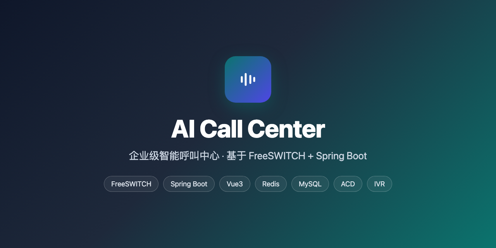
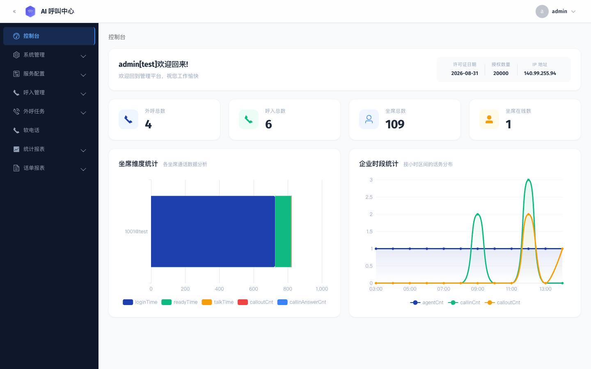
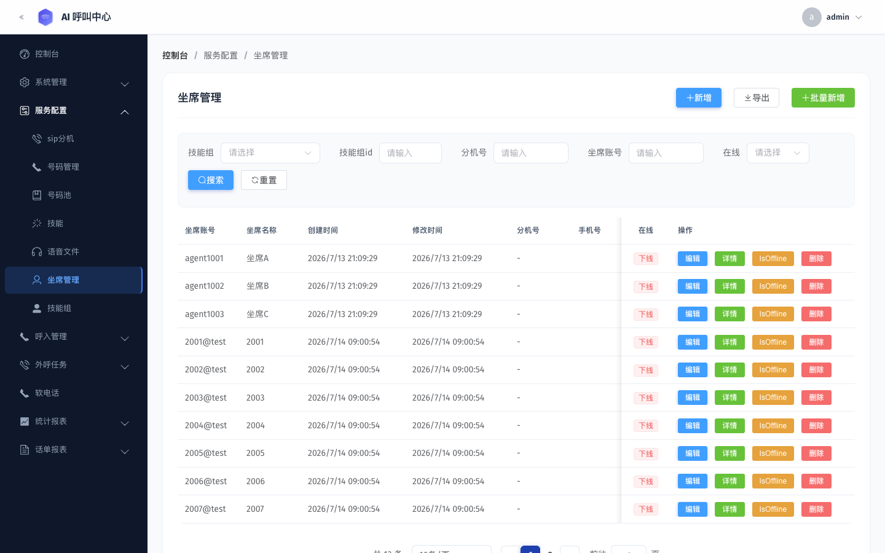
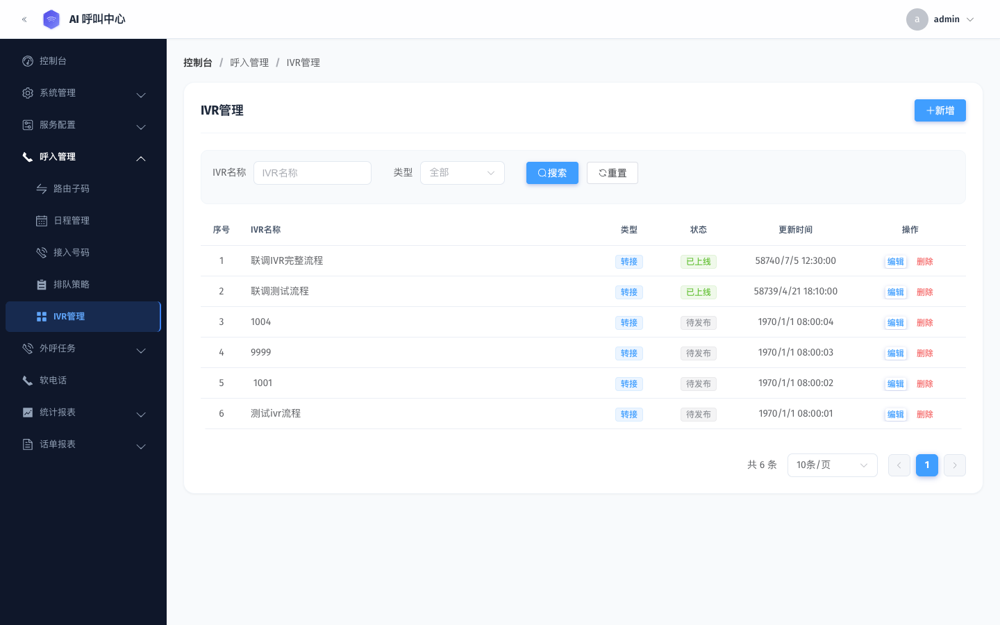
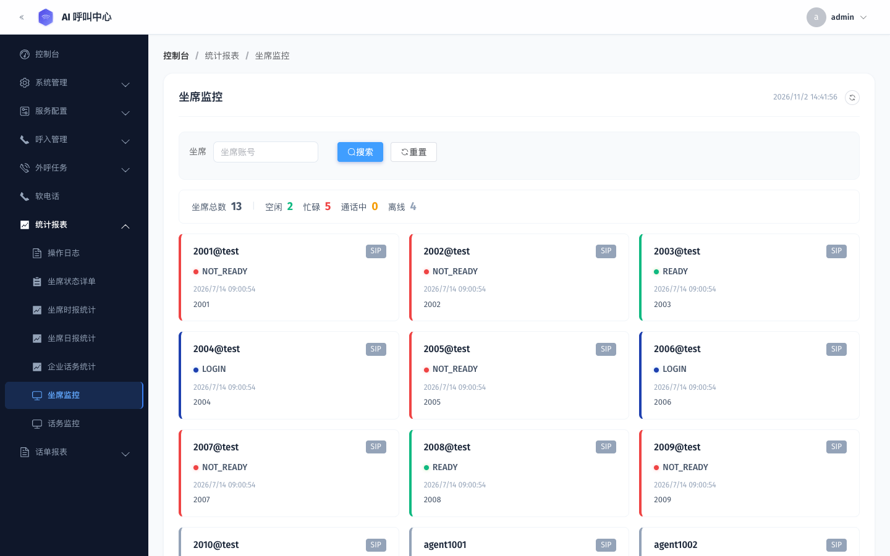
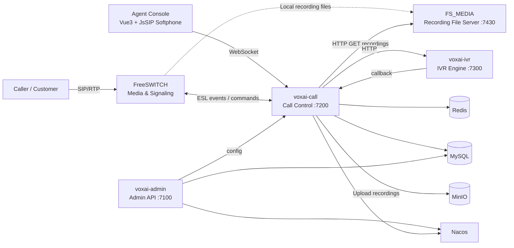

# AI Call Center · 开源呼叫中心系统

基于 FreeSWITCH、Spring Boot 和 Vue 3 的开源呼叫中心系统，支持多租户、人工呼入呼出、智能外呼任务、ACD 技能组路由、IVR、WebRTC 坐席与录音管理，适用于企业客服和外呼业务，也可作为 AI 语音应用的呼叫底座。

An enterprise-grade AI call center system built on FreeSwitch and Spring Boot, providing multi-tenant, multi-skill-group, and intelligent routing — a complete set of call center capabilities.

[中文](README_zh.md) | English

[](LICENSE)
[](https://github.com/dongjb741280/ai-call-center/releases)
[](https://github.com/dongjb741280/ai-call-center)

<p align="center"></p>

> 🌟 If this project helps you, please give it a ⭐ Star! 🙏

Official site: <https://dongjb741280.github.io/ai-call-center/>

## Overview

This is an AI call center solution built on a microservices architecture, integrating FreeSwitch as the call engine and providing complete call management, agent management, intelligent routing, monitoring and statistics. It supports multi-company and multi-skill-group management, with enterprise-grade high-concurrency and high-availability characteristics.

> This project is primarily intended for large-scale human inbound and outbound calling scenarios, or as the foundation for AI-powered unattended calling.
>
> For a pure AI call center (unattended-first), please refer to:
>
> <https://github.com/dongjb741280/IntelliCall-Pro>

## Screenshots

| Dashboard | Agent Management |
| --- | --- |
|  |  |

| IVR Management | Agent Monitor |
| --- | --- |
|  |  |

## Demo

<p align="center"></p>

## Technical Architecture



`FS_MEDIA` serves FreeSWITCH local recording files over HTTP on port `7430`. After hangup, `voxai-call` downloads recordings from this server and uploads them to MinIO. See [Recording Upload Flow](docs/12-录音上传MinIO.md).

### Project Structure

```text
ai-call-center/
├── voxai-common/          # Core business module (data layer)
├── voxai-admin/           # Admin API service (port 7100)
├── voxai-call/            # FreeSwitch integration service (port 7200)
├── voxai-ivr/             # IVR engine service (port 7300)
├── voxai-dialer/          # External outbound scheduler (HTTP client, disabled by default)
├── freeswitch/            # FreeSwitch configuration and Docker image
├── portal/                # Product portal (VoxHub)
├── docs/                  # Business docs (scope/flows/data model/engine interfaces)
├── .github/workflows/     # GitHub Actions (portal CI/CD)
├── .gitlab-ci.yml         # GitLab CI/CD pipeline
└── Dockerfile             # Multi-stage Docker build
```

### Tech Stack

- **Backend framework**: Spring Boot 2.3.12
- **Microservices**: Spring Cloud + Nacos
- **Database**: MySQL/PostgreSQL/Oracle/SQL Server (multi-database support)
- **Cache**: Redis
- **Message queue**: RabbitMQ (optional Kafka)
- **File storage**: MinIO
- **Call engine**: FreeSwitch
- **Build tool**: Maven + Jib (build images without a Docker Daemon)
- **Image registry**: Harbor
- **Containerization**: Docker
- **CI/CD**: GitLab CI + Watchtower auto-deploy

## Core Modules

### voxai-common (Core Business Module)

- **Entities**: company, agent, skill group, call records and other business entities
- **Data access**: MyBatis mappers
- **Utilities**: encryption, ID generation and other common utilities

### voxai-admin (Admin API Service)

- **Administration**: agent management, skill group management, company configuration
- **Auth**: Spring Security + JWT
- **Scheduled tasks**: Quartz scheduler
- **Statistics**: call statistics, agent state statistics
- **File management**: MinIO integration

### voxai-call (FreeSwitch Integration Service)

- **Call control**: inbound/outbound, transfer, hold, mute, etc.
- **Intelligent routing**: ACD (Automatic Call Distribution) algorithms
- **Agent state**: real-time state management and monitoring
- **WebSocket**: real-time communication
- **TCP service**: agent state subscription
- **Event handling**: FreeSwitch event listening and processing

### voxai-ivr (IVR Engine Service)

- **Flow engine**: parses `cc_ivr_workflow.content` into a node graph, executes by play/input/transfer
- **Interaction**: playback and digit collection via FreeSwitch `playback` / `play_and_get_digits`
- **Handoff**: calls back `voxai-call` on completion to route to skill group/agent/VDN/hangup

### voxai-dialer (Outbound Task Engine)

Independent scheduler with cruise/predictive pacing, command acknowledgements, lease recovery and CDR result submission. See [deployment and recovery](docs/15-外部拨号引擎.md) before enabling.

## Core Features

### 1. Call Management

- **Inbound handling**: automatic routing to a skill group
- **Outbound**: agent-initiated calls
- **Call transfer**: agent-to-agent transfer, skill-group transfer
- **Call hold**: hold / unhold
- **Mute control**: agent mute / unmute

### 2. Inbound Routing (VDN / IVR)

- **VDN identification**: service number matches `cc_vdn_phone` → `cc_vdn_code`, selects the active route by `cc_vdn_schedule` (weekday/date/time range)
- **Route types** (`cc_vdn_config.route_type`): skill group / playback / IVR / agent / outbound
- **Digit navigation**: collect digits with `play_and_get_digits` after playback, match against `cc_vdn_dtmf` to route to skill group/IVR/route code/agent extension/hangup
- **IVR engine**: `voxai-ivr` parses the `cc_ivr_workflow` definition, executes play/input/transfer, then hands back

### 3. Intelligent Routing (ACD)

- **Multiple assignment strategies**:
  - Least answered
  - Least talk time
  - Longest ready
  - Random
  - Round-robin
  - Custom

### 4. Skill Group Management

- **Queuing strategies**: priority queue, VIP queue
- **Overflow handling**: queue timeout, skill-group overflow
- **Memory agent**: match the customer's historical agent

### 5. Agent Management

- **State management**: ready, busy, talking, offline, etc.
- **Multiple login methods**: SIP, WebRTC, phone
- **Access control**: role-based permission management

### 6. Monitoring & Statistics

- **Real-time monitoring**: agent state, call state
- **Statistics**: call volume, answer rate, average talk time
- **Report export**: Excel report export

## Getting Started

### Requirements

- JDK 1.8+
- Maven 3.6+
- MySQL 5.7+ / PostgreSQL 10+ / Oracle 11g+ / SQL Server 2016+
- Redis 5.0+
- FreeSwitch 1.10+
- Docker & Docker Compose

### Database Setup

1. Create the database
2. Initialize the database: table scripts and migration SQL are under `docs/sql/` (`voxai.sql` full database dump, `migration_*.sql` incremental migrations)
3. Update the database connection settings in the config file

### Configuration Files

Edit `application-dev.properties`:

```properties
# Database
spring.datasource.url=jdbc:mysql://localhost:3306/voxai
spring.datasource.username=root
spring.datasource.password=your_password

# Redis
spring.redis.host=localhost
spring.redis.port=6379
spring.redis.password=your_redis_password

# MinIO
voxai.minio.endpoint=http://localhost:9000
voxai.minio.access.key=admin
voxai.minio.secret.key=your_secret_key
```

### Build & Run

#### 1. Compile the project

```bash
# Build all modules (skip tests)
mvn clean install -DskipTests

# Build a single module
mvn clean install -pl voxai-admin -DskipTests
```

#### 2. Run locally

```bash
# voxai-admin (admin backend, port 7100)
java -jar voxai-admin/target/voxai-admin-1.0.0.jar

# voxai-call (call service, port 7200)
java -jar voxai-call/target/voxai-call-1.0.0.jar

# voxai-ivr (IVR engine, port 7300)
java -jar voxai-ivr/target/voxai-ivr-1.0.0.jar
```

#### 3. Build images with Jib (no Docker Daemon required)

```bash
# Build and push to Harbor
mvn compile jib:build -pl voxai-admin,voxai-call \
  -DsendCredentialsOverHttp=true \
  -Ddocker.repostory=localhost:8444 \
  -Djib.to.tags=latest

# Or build to the local Docker Daemon
mvn compile jib:dockerBuild -pl voxai-admin
```

#### 4. Run with Docker

```bash
# Pull from Harbor and start
docker pull localhost:8444/voxai/voxai-admin:latest
docker run -d --name voxai-admin --network host \
  localhost:8444/voxai/voxai-admin:latest
```

### API Docs (Swagger/OpenAPI)

- voxai-admin: `http://localhost:7100/voxai-admin/swagger-ui/index.html`
- voxai-call: `http://localhost:7200/voxai-call/swagger-ui/index.html`

## Deployment Architecture

### Microservice Deployment

- **voxai-admin**: admin backend service (port 7100)
- **voxai-call**: call control service (port 7200)
- **voxai-ivr**: IVR engine service (port 7300)
- **FS_MEDIA**: recording file server on the FreeSWITCH media node (HTTP port 7430), used by `voxai-call` to retrieve local recordings
- **freeswitch**: call engine (port 5060)

### Data Storage

- **MySQL**: business data storage
- **Redis**: cache and session storage
- **MinIO**: recording files and media storage

### CI/CD Pipeline

```text
Compile → Unit Tests → SonarQube → Package → Jib Build (Harbor) → Nexus Publish → 1Panel API Deploy
                                                                               ↓
                                                                    Watchtower (k8s-work-4)
                                                                    Dual safeguard, auto pull & restart
```

- **CI (GitLab)**: build, test, code scan, Jib pushes images to Harbor
- **Harbor**: local image registry (`localhost:8444`)
- **Dual CD safeguard**:
  - **Option A (1Panel API)**: CI actively triggers `images/pull` + `containers/upgrade`
  - **Option B (Watchtower)**: runs in the background on k8s-work-4, periodically checks and auto-deploys
  - Both coexist without conflict; either one succeeding is enough

#### Watchtower Deployment (k8s-work-4)

```bash
docker run -d \
  --name watchtower --restart unless-stopped \
  -v /var/run/docker.sock:/var/run/docker.sock \
  -v /root/.docker/config.json:/config.json \
  -e DOCKER_CONFIG=/ \
  containrrr/watchtower \
  --interval 30 --cleanup \
  voxai-admin voxai-call
```

> Depends on the Harbor login credentials in `/root/.docker/config.json`

#### GitLab CI Variables

| Variable | Description |
| ------ | ------ |
| `HARBOR_REGISTRY` | Harbor image registry address |
| `HARBOR_REGISTRY_USER` | Harbor username |
| `HARBOR_REGISTRY_PASS` | Harbor password |
| `ONEPANEL_URL` | 1Panel panel address (Option A) |
| `ONEPANEL_API_KEY` | 1Panel API Key (Option A) |
| `SONAR_HOST_URL` | SonarQube server address |
| `SONAR_TOKEN` | SonarQube Token |
| `NEXUS_URL` / `NEXUS_USER` / `NEXUS_PASSWORD` | Nexus repository credentials |

## Configuration

### Multi-environment Support

- Development (dev)
- Production (prod)
- Nacos config center integration

### Multi-database Support

- MySQL (primary)
- PostgreSQL
- Oracle
- SQL Server

### Security Features

- JWT token authentication
- Encrypted password storage
- API permission control

## API Documentation

> Admin context path `/voxai-admin` (port 7100), call context path `/voxai-call` (port 7200).

### Main Endpoints

#### Login & Health

- `POST /voxai-admin/index/login` - admin login
- `GET /voxai-admin/index/logout` - admin logout
- `GET /voxai-admin/index/health` - admin health check
- `GET /voxai-call/index/health` - call health check

#### Agent & Skill Group (voxai-admin `/config`)

- `GET /voxai-admin/config/agent` - agent list
- `POST /voxai-admin/config/agent` - add agent
- `GET /voxai-admin/config/group` - skill group list
- `POST /voxai-admin/config/group` - add skill group
- `GET /voxai-admin/config/group/agent/{id}` - agents in a skill group

#### Call Control (voxai-call `/cti`)

- `POST /voxai-call/cti/call/makeCall` - make a call
- `POST /voxai-call/cti/call/hangup` - hang up
- `POST /voxai-call/cti/call/hold` / `cancelHold` - hold / unhold
- `POST /voxai-call/cti/call/readyMute` / `cancelMute` - mute / unmute
- `POST /voxai-call/cti/agent/ready` / `notReady` - set ready / not ready
- `POST /voxai-call/cti/agent/logout` - agent logout
- `GET /voxai-call/cti/admin/call` - call list

## Monitoring & Operations

### Health Checks

- `GET /voxai-admin/index/health` - voxai-admin health check (port 7100)
- `GET /voxai-call/index/health` - voxai-call health check (port 7200)

### Logging

- Logback logging configuration
- ELK log collection support
- Structured log output

### Performance Monitoring

- Prometheus metrics collection
- JVM performance monitoring
- Database connection pool monitoring

## Development Guide

### Code Structure

```text
src/main/java/
├── com.voxai.api/          # API service
│   ├── web/                 # Controller layer
│   ├── service/             # Service layer
│   └── configration/        # Configuration classes
├── com.voxai.core/         # Core module
│   ├── entity/              # Entities
│   ├── mapper/              # Data access layer
│   └── enums/               # Enums
└── com.voxai/              # FreeSwitch integration
    ├── cc/                  # Call control
    ├── fs/                  # FreeSwitch event handling
    └── websocket/           # WebSocket communication
```

### Development Conventions

- Follow the Alibaba Java Development Manual
- Use a unified exception handling mechanism
- Support multi-tenant data isolation
- Async processing for better performance

## FAQ

### Q: How do I configure FreeSwitch?

A: Refer to the configuration files under `freeswitch/`, which support both CentOS and Debian.

### Q: How do I add a new assignment strategy?

A: Implement a new assignment algorithm under `voxai-call/src/main/java/com/voxai/cc/acd/assign/`.

### Q: How do I integrate with third-party systems?

A: Integrate via WebHook callbacks or message queues, supporting HTTP and RabbitMQ.

### Q: How do I extend agent functionality?

A: Add new entities and interfaces in the `voxai-common` module, and implement the concrete business logic in `voxai-admin`.

## License

This project is licensed under the MIT License. See the [LICENSE](LICENSE) file for details.

## Contributing

1. Fork the repository
2. Create a feature branch (`git checkout -b feature/AmazingFeature`)
3. Commit your changes (`git commit -m 'Add some AmazingFeature'`)
4. Push to the branch (`git push origin feature/AmazingFeature`)
5. Open a Pull Request

## Contact

- Author: dongjianbin
- Email: <dongjb741280@gmail.com>
- Repository: [GitHub Repository](https://github.com/dongjb741280/ai-call-center)

## Changelog

### v1.0.1 (2026-07-31)

- Integrated Jib image builds, removing the Docker Daemon dependency
- Added GitLab CI + Harbor + Watchtower auto-deploy pipeline
- Unified Harbor environment variable naming (`HARBOR_REGISTRY` prefix)

### v1.0.0 (2024-01-01)

- Initial release
- Basic call center features
- FreeSwitch call engine integration
- Multi-tenant management
- Complete API endpoints

---

**Note**: This project is for learning and research only. For commercial use, please ensure compliance with relevant laws and regulations.
