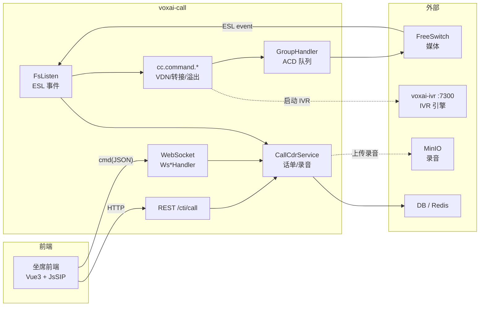
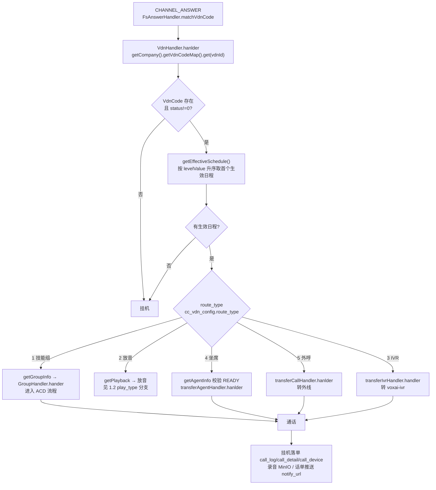
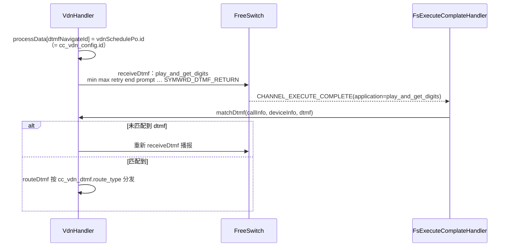
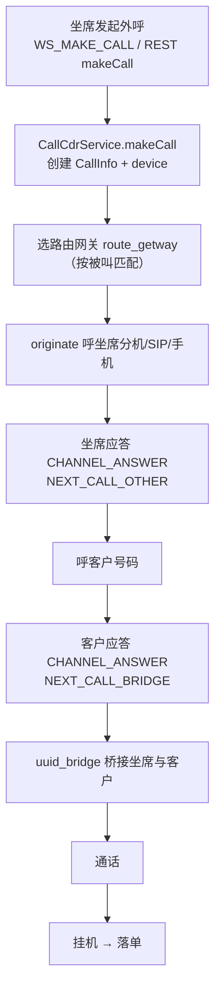
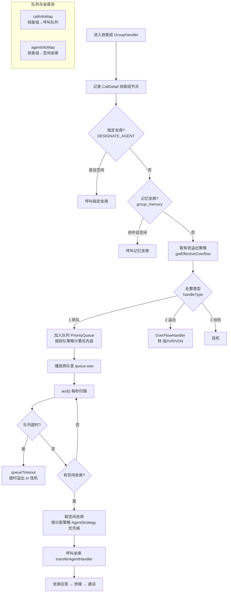
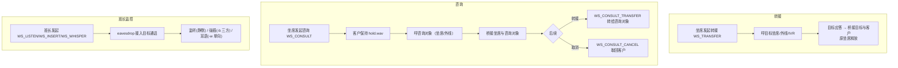
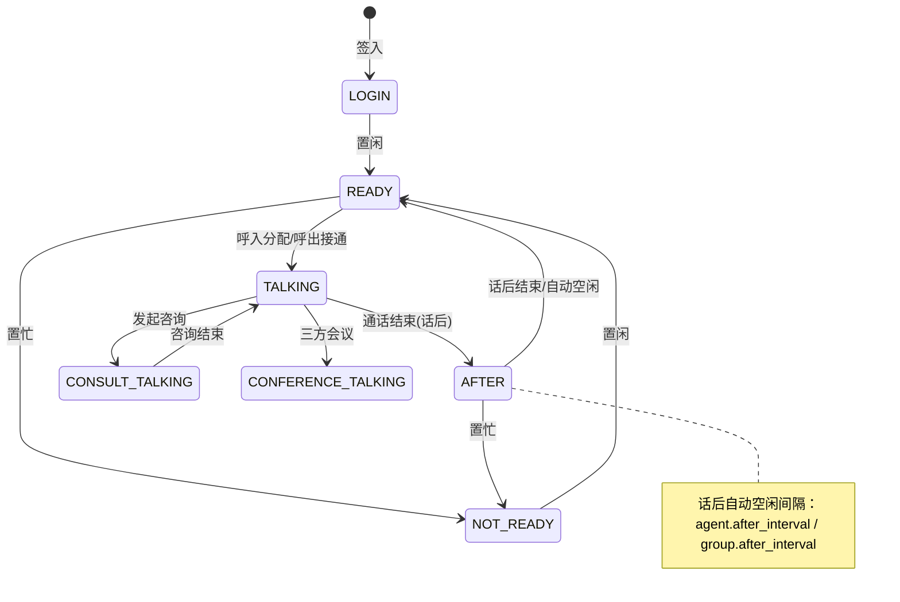
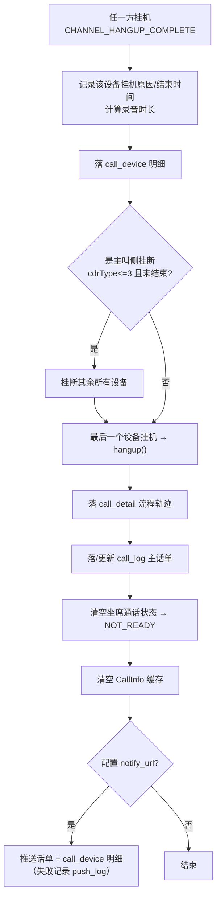
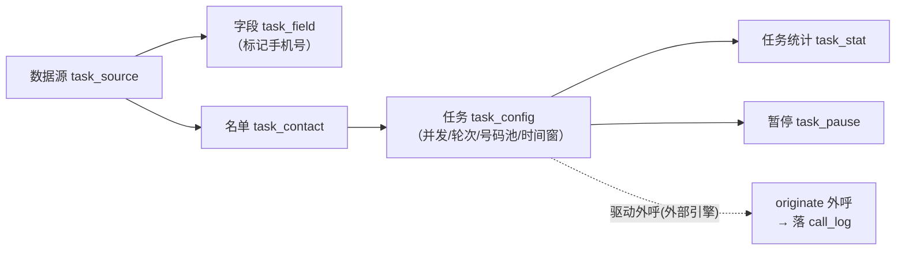

# 02 · 业务流程

> 流程图基于 `voxai-call` 模块实际代码梳理（`FsListen`、`Fs*Handler`、`cc.command.*`、`cc.acd.*`、
> `cc.websocket.handler.*`、`CallCdrService`）。图使用 Mermaid。

## 0. 总体架构与事件驱动模型

`FsListen` 连接 FreeSwitch（`cc_station` 中 `application_type=4` 的媒体服务），订阅全部 ESL 事件，
按事件名通过 `HandlerContext` 分发到 `@HandlerType` 标注的处理器。呼叫链路状态保存在 Redis（`CacheService`），
核心对象为 `CallInfo`（一次通话）与 `DeviceInfo`（通话中的一个「腿」/设备）。

## 1. 呼入流程（Inbound）与 VDN 路由

客户拨打企业特服号，FreeSwitch 应答后触发 `CHANNEL_ANSWER`，进入 `FsAnswerHandler.matchVdnCode`：
用特服号查 `cc_vdn_phone` 定位 `vdn_id`，校验企业有效后进入 `VdnHandler.hanlder` 按有效日程路由。
VDN 是呼入路由的中枢，下面分「主路由」「日程匹配」「按键导航」三块展开。

### 1.1 主路由（`VdnHandler.hanlder`）

### 1.2 日程匹配（`VdnSchedulePo.isEffectiveSchedule`）

`cc_vdn_config`（子码日程/路由项）通过 `schedule_id` 关联 `cc_vdn_schedule`（日程）。`VdnSchedulePo` 是二者的聚合
（`extends VdnConfig` + 内嵌 `scheduleConfig`），`getEffectiveSchedule()` 遍历已按 `levelValue` 升序排序的
`vdnSchedulePoList`，返回第一个满足全部条件的日程：

1. **星期**：`LocalDate.getDayOfWeek().getValue()`（1=周一 … 7=周日）对应 `mon..sun` 开关，命中天为 `0` 则不生效。
2. **日期范围**（`cc_vdn_schedule.type`）：
   - `type=1` 指定日期：`start_day`/`end_day` 为完整日期 `yyyy-MM-dd`，按 `isAfter`/`isBefore` 比较。
   - `type=2` 相对日期：`start_day`/`end_day` 为天号（1~31），按 `dayOfMonth` 比较。
3. **时间段**：`start_time`/`end_time`（`HH:mm:ss`）限定当天生效区间。

### 1.3 放音与按键导航（play_type）

`cc_vdn_config.play_type` 决定放音后的去向：

| `play_type` | 含义 | 处理 |
| --- | --- | --- |
| 1 | 按键导航 | 记 `dtmfNavigateId` 后 `receiveDtmf` 收键，走 1.4 |
| 2 / 3 / 4 / 5 | 技能组 / IVR / 路由字码 / 挂机 | 放音后 `doNextCommand` 转目标 |

### 1.4 按键导航收键（DTMF）

`receiveDtmf` 下发 `play_and_get_digits`，收键参数取自 `cc_vdn_config` 的 `dtmf_min`/`dtmf_max`/`retry`/`dtmf_end`，
提示音 `prompt` 取 `cc_playback.playback`。收键完成后由 `FsExecuteComplateHandler` 捕获
`CHANNEL_EXECUTE_COMPLETE`，调用 `matchDtmf`：从 `CallInfo.processData` 取 `dtmfNavigateId`，
`findSchedule` 遍历 `getVdnCodeMap` 的 `vdnSchedulePoList` 按 `id` 定位当前 `VdnSchedulePo`，
再遍历其 `dtmfList`（`cc_vdn_dtmf`）精确匹配按键；未命中则重新 `receiveDtmf` 播报。命中后按 `cc_vdn_dtmf.route_type` 路由：

| `cc_vdn_dtmf.route_type` | 含义 | 处理 |
| --- | --- | --- |
| 1 | 技能组 | `getGroupInfo` → `GroupHandler.hander` |
| 2 | IVR | `transferIvrHandler.handler` |
| 3 | 路由字码 | `vdnHandler.hanlder`（递归进下一级 VDN） |
| 4 | 坐席分机 | `getAgentBySip(routeValue)` → 校验 READY → `transferAgentHandler.hanlder` |
| 5 | 挂机 | `hangupCall` |

### 1.5 三种路由枚举对照

VDN 链路里 `route_type` 出现三次、语义不同，务必区分：

| 字段 | 取值 |
| --- | --- |
| `cc_vdn_config.route_type` | 1技能组 / 2放音 / 3IVR / 4坐席 / 5外呼 |
| `cc_vdn_config.play_type` | 1按键导航 / 2技能组 / 3IVR / 4路由字码 / 5挂机 |
| `cc_vdn_dtmf.route_type` | 1技能组 / 2IVR / 3路由字码 / 4坐席分机 / 5挂机 |

## 2. 呼出流程（坐席外呼）

坐席通过 WebSocket 或 REST 发起外呼，`CallCdrService.makeCall` 创建 `CallInfo`，经媒体网关
`bgapi originate` 呼坐席，坐席应答后呼客户，客户应答后桥接。

## 3. ACD 排队与分配流程

电话进入技能组后的核心流程，含指定坐席、记忆坐席、溢出策略、排队与定时分配。

### 3.1 分配策略（`cc.acd.assign` / `AgentStrategy`）

| 策略实现 | 含义（对应 `strategy_value`） |
| --- | --- |
| `LongReadyAssign` | 1 最长空闲时间 |
| `TotalReadyAssign` / `TotalReadyTimesAssign` | 2 最长平均空闲 |
| `LeastAnswerAssign` | 3 最少应答次数 |
| `LeastTalkAssign` | 4 最少通话时长 |
| `TotalAfterTimeAssign` | 5 最长话后时长 |
| `PollAssign` | 6 轮选 |
| `RandomAssign` | 7 随机 |
| `AgentCustomAssign` | 自定义（`customExpression` SpEL / `cc_group_strategy_exp`） |

### 3.2 排队策略（`cc.acd.lineup` / `LineupStrategy`）

| 策略实现 | 含义（对应 `busy_type`） |
| --- | --- |
| `DefaultLineupStrategy` | 1 先进先出 |
| `VipLineupStrategy` | 2 VIP 优先 |
| `CustomLineupStrategy` | 3 自定义表达式 |

## 4. 转接 / 咨询 / 会议 / 班长监控

## 5. 坐席状态机

`AgentState` 枚举定义了坐席完整状态，`GroupHandler.agentFree/agentNotReady` 维护空闲坐席池。

## 6. 挂机与落单流程

## 7. 外呼任务流程（配置域）

任务域数据由 admin 管理；拨号引擎为外部组件。这里给出数据侧关系：

## 8. 坐席状态订阅（TCP，供第三方系统）

`TcpServer` 提供坐席状态订阅，`Sub*Handler` 处理订阅事件，用于第三方系统（CRM 等）实时获取坐席状态与通话事件。

| 订阅事件 | 说明 |
| --- | --- |
| `SubLogin` | 登录订阅 |
| `SubMakeCall` / `SubAnswer` | 呼叫/应答事件 |
| `SubStartCall` / `SubStopCall` | 通话开始/结束 |
| `SubPlayFile` / `SubQueuePlay` / `SubQueuePlayStop` | 放音事件 |
| `SubTransferTo` | 转接事件 |
