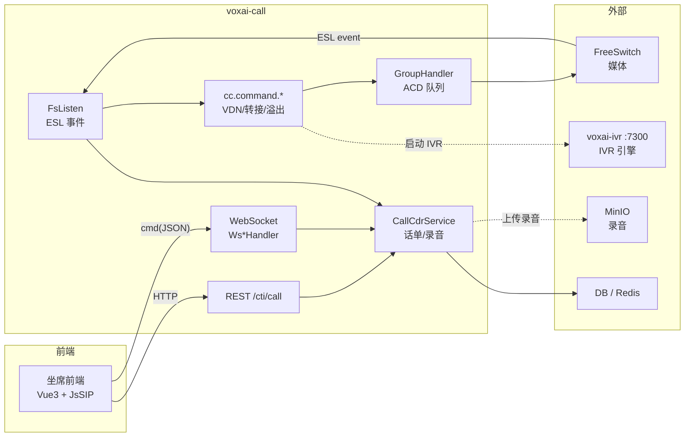
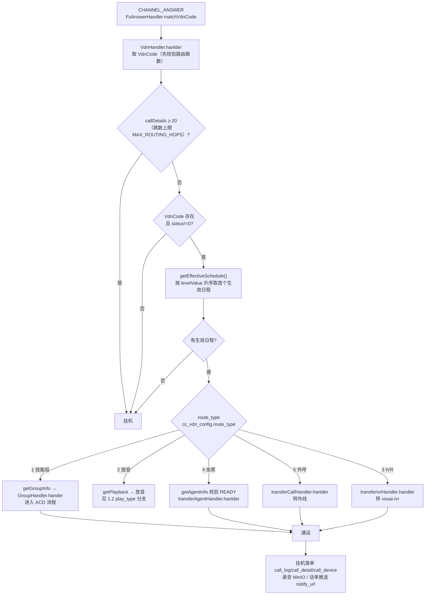
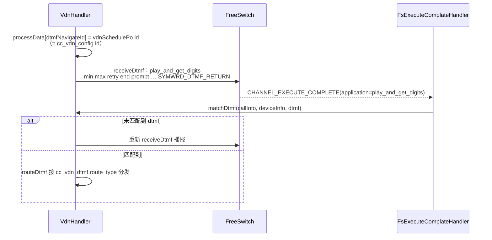
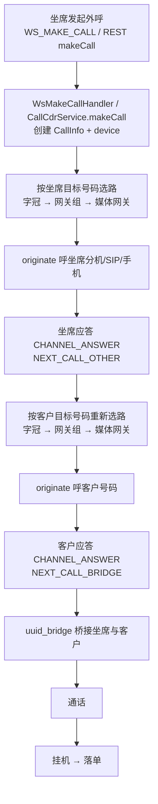
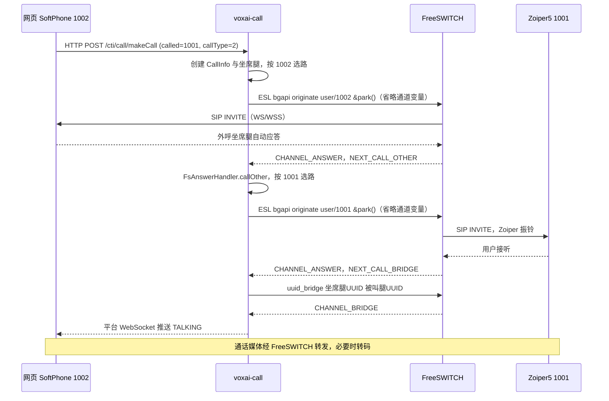
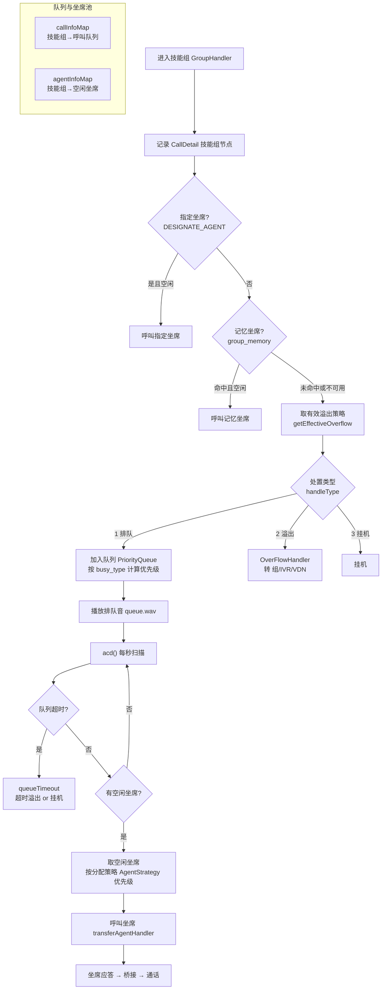
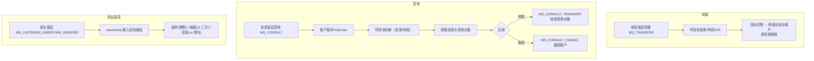
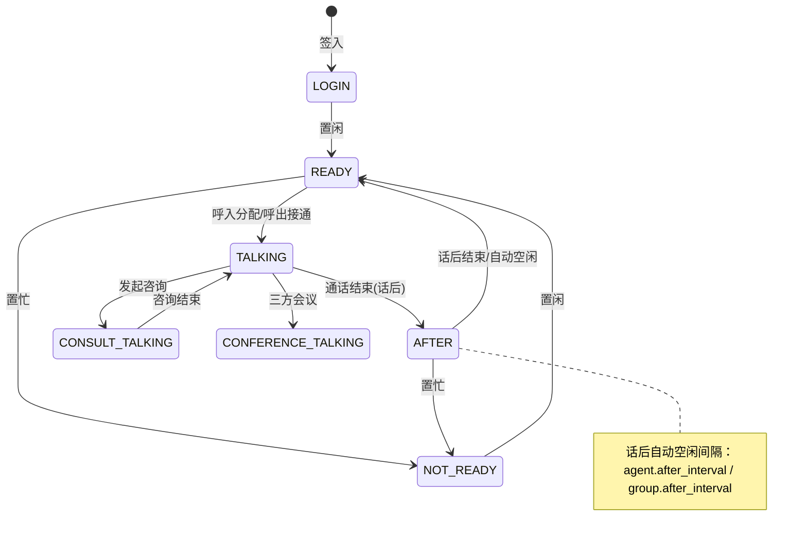
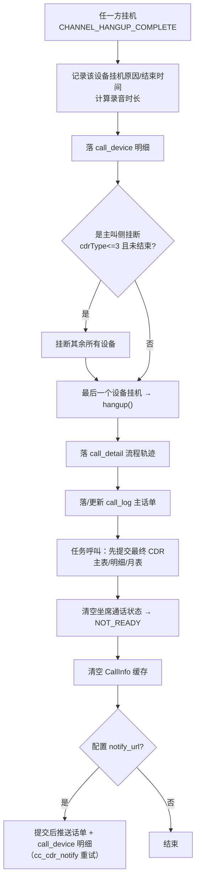
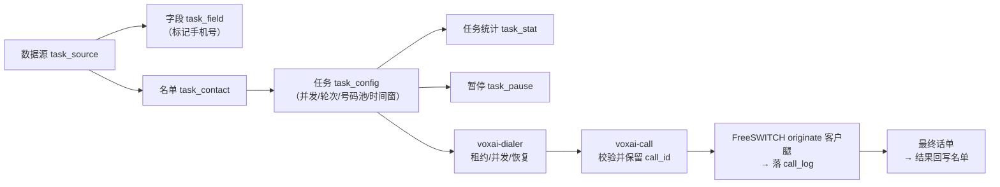

# 02 · 业务流程

> 流程图基于 `voxai-call` 模块实际代码梳理（`FsListen`、`Fs*Handler`、`cc.command.*`、`cc.acd.*`、
> `cc.websocket.handler.*`、`CallCdrService`）。图使用 Mermaid。

## 0. 总体架构与事件驱动模型

`FsListen` 连接 FreeSwitch（`cc_station` 中 `application_type=4` 的媒体服务），订阅全部 ESL 事件，
按事件名通过 `HandlerContext` 分发到 `@HandlerType` 标注的处理器。呼叫链路状态保存在 Redis（`CacheService`），
核心对象为 `CallInfo`（一次通话）与 `DeviceInfo`（通话中的一个「腿」/设备）。

## 1. 呼入流程（Inbound）与 VDN 路由

客户拨打企业接入号码（后台称特服号），运营商先将电话送到 FreeSwitch。
`FsParkHandler.inboundCall` 按被叫号码匹配 `cc_vdn_phone`，确定企业并创建呼入 `CallInfo`；未匹配则记录失败话单并挂机。
FreeSwitch 应答后触发 `CHANNEL_ANSWER`，进入 `FsAnswerHandler.matchVdnCode`，定位 `vdn_id`，
校验企业有效后进入 `VdnHandler.hanlder` 按有效日程路由。
VDN 是呼入路由的中枢，下面分「主路由」「日程匹配」「按键导航」三块展开。

**呼入入口不调用字冠 → 网关组 → 媒体网关选路**。但 ACD 分配坐席后，`TransferAgentHandler` 主动呼叫坐席端时，
仍会按坐席号码选路；转外线时也会按转接号码选路。整通通话的呼入方向，与后续是否需要主动建立新呼叫腿是两个维度。

### 1.1 主路由（`VdnHandler.hanlder`）

入口先校验路由跳数：`callInfo.getCallDetails().size() >= MAX_ROUTING_HOPS(20)` 即挂机，防止 VDN 间成环
（如放音后转路由字码自指/互指）导致无限循环。

### 1.2 日程匹配（`VdnSchedulePo.isEffectiveSchedule`）

`cc_vdn_config`（子码日程/路由项）通过 `schedule_id` 关联 `cc_vdn_schedule`（日程）。`VdnSchedulePo` 是二者的聚合
（`extends VdnConfig` + 内嵌 `scheduleConfig`），`getEffectiveSchedule()` 遍历已按 `levelValue` 升序排序的
`vdnSchedulePoList`，返回第一个满足全部条件的日程：

1. **星期**：`LocalDate.getDayOfWeek().getValue()`（1=周一 … 7=周日）对应 `mon..sun` 开关，命中天为 `0` 则不生效。
2. **日期范围**（`cc_vdn_schedule.type`）：
   - `type=1` 指定日期：`start_day`/`end_day` 为完整日期 `yyyy-MM-dd`，按 `isAfter`/`isBefore` 比较。
   - `type=2` 相对日期：`start_day`/`end_day` 为天号（1~31），按 `dayOfMonth` 比较。
3. **时间段**：`start_time`/`end_time`（`HH:mm:ss`）限定当天生效区间。

### 1.3 放音与按键导航（play_type）

`cc_vdn_config.play_type` 决定放音后的去向：

| `play_type` | 含义 | 处理 |
| --- | --- | --- |
| 1 | 按键导航 | 记 `dtmfNavigateId` 后 `receiveDtmf` 收键，走 1.4 |
| 2 / 3 / 4 / 5 | 技能组 / IVR / 路由字码 / 挂机 | 放音前把 `nextCommand` 入队并持久化，放音结束（`PLAYBACK_STOP`）后由 `FsPlaybackStopHandler` 执行 `doNextCommand` 转目标 |

放音类型 2/3/4/5 的链路：先在 `VdnHandler` 里构造 `NextCommand`（`NEXT_GROUP`/`NEXT_IVR`/`NEXT_VDN`/`NEXT_HANGUP`）
入队并 `addCallInfo` 持久化，再 `playback` 放音；放音结束触发 `PLAYBACK_STOP`，由 `FsPlaybackStopHandler`
取出队首 `nextCommand` 执行 `doNextCommand` 转目标。

### 1.4 按键导航收键（DTMF）

`receiveDtmf` 下发 `play_and_get_digits`，收键参数取自 `cc_vdn_config` 的 `dtmf_min`/`dtmf_max`/`retry`/`dtmf_end`，
提示音 `prompt` 取 `cc_playback.playback`。收键完成后由 `FsExecuteComplateHandler` 捕获
`CHANNEL_EXECUTE_COMPLETE`，调用 `matchDtmf`：从 `CallInfo.processData` 取 `dtmfNavigateId`，
`findSchedule` 遍历 `getVdnCodeMap` 的 `vdnSchedulePoList` 按 `id` 定位当前 `VdnSchedulePo`，
再遍历其 `dtmfList`（`cc_vdn_dtmf`）精确匹配按键；未命中则重新 `receiveDtmf` 播报。命中后按 `cc_vdn_dtmf.route_type` 路由：

| `cc_vdn_dtmf.route_type` | 含义 | 处理 |
| --- | --- | --- |
| 1 | 技能组 | `getGroupInfo` → `GroupHandler.hander` |
| 2 | IVR | `transferIvrHandler.handler` |
| 3 | 路由字码 | `vdnHandler.hanlder`（递归进下一级 VDN） |
| 4 | 坐席分机 | `getAgentBySip(routeValue)` → 校验 READY → `transferAgentHandler.hanlder` |
| 5 | 挂机 | `hangupCall` |

`cc_vdn_dtmf` 按键分支由 voxai-admin 提供 CRUD 接口：`GET/POST /voxai-admin/config/vdn/config/{configId}/dtmf`、
`PUT/DELETE /voxai-admin/config/vdn/dtmf/{id}`，供前台配置按键导航分支。

### 1.5 三种路由枚举对照

VDN 链路里 `route_type` 出现三次、语义不同，务必区分：

| 字段 | 取值 |
| --- | --- |
| `cc_vdn_config.route_type` | 1技能组 / 2放音 / 3IVR / 4坐席 / 5外呼 |
| `cc_vdn_config.play_type` | 1按键导航 / 2技能组 / 3IVR / 4路由字码 / 5挂机 |
| `cc_vdn_dtmf.route_type` | 1技能组 / 2IVR / 3路由字码 / 4坐席分机 / 5挂机 |

## 2. 呼出流程（坐席外呼）

坐席通过 WebSocket 或 REST 发起外呼，由对应的 `WsMakeCallHandler` / `CallCdrService.makeCall` 创建 `CallInfo`。
平台先按坐席目标号码选择字冠、网关组和媒体网关，通过 `bgapi originate` 呼叫坐席；坐席应答后，
再按客户目标号码重新选路并呼叫客户，客户应答后桥接。两段呼叫可以使用不同的出口。

### 2.1 拨打短特服号码（以 10010 为例）

坐席拨打外部 `10010` 时，客户端这段呼叫仍按「`10010` → 字冠 → 网关组 → 媒体网关 → 线路商」执行，
不会因为号码较短而绕过选路，也不需要将它配置成平台的呼入 VDN 号码。

1. 配置支持该短号码的媒体网关，加入相应网关组。
2. 可配置字冠 `10010`、最小/最大长度均为 `5` 指向该组，或由长度范围包含 5 的默认规则承接。若 `100` 已用于内部分机，应通过更具体的 `10010` 规则区分。
3. 按线路商要求检查字冠被叫改写及网关前缀；无字冠改写时，`calledPrefix=9` 会实际发送 `910010`，不能默认所有线路都需要此处理。
4. 确认线路允许拨打该特服号码及其地区接续规则；普通手机号码可拨通不代表短特服号码一定可拨通。

当前选路使用严格前缀和号码长度匹配；网关组按配置使用轮询、权重或顺序主备，明确线路故障时可进入下一网关；
字段执行范围、默认规则次序及企业/全局字冠冲突详见 [业务范围 §3.6](01-业务范围.md#36-出局路由与网关)。

### 2.2 每段主动拨号的选路顺序

1. 合并本企业与全局字冠；相同字冠由企业规则完整覆盖全局规则。
2. 对原始目标号码按最长前缀优先匹配，并检查号码长度；不符合时继续下一条，`*` 最后检查且仍检查长度。
3. 在命中的网关组中过滤停用、冷却中的网关，再按轮询、权重或主备顺序选出口；无可用网关则失败，不跳往其他字冠。
4. 对该段主叫显号、被叫目标先执行字冠“删除位数 + 新前缀”，再添加网关主/被叫前缀，组装 FreeSWITCH 拨号地址。
5. 下发 `bgapi originate`，应答后进入桥接、转接或该呼叫腿约定的下一步。

### 2.3 线路故障后的组内换线

非任务呼叫在该段尚未振铃、未收到早期媒体且未接通时遇到明确线路故障，会先保存失败设备明细，
再尝试同组下一可用网关。新设备使用新的 `device_id`，保留同一 `call_id` 和后续业务命令；
改写始终从原始号码重新计算，避免重复添加前缀。候选网关用尽后按原有挂机流程收尾。

忙线、拒接、无人接听、已振铃/早期媒体、已接通以及整通电话已结束时不换线。
三种组选路策略都遵守这些条件；故障网关进入本节点 30 秒冷却，影响后续选路。
普通呼叫的 originate 发送异常或后台失败结果进入同一套挂机、设备明细和换线处理。
外呼任务保持同一 attempt 不重复 originate，重拨由任务轮次和结果控制，详见 [外部拨号引擎 §3](15-外部拨号引擎.md#3-命令租约和重拨)。

### 2.4 网页 SoftPhone 拨打 Zoiper5

以网页坐席绑定 WebRTC 分机 `1002`、Zoiper5 注册分机 `1001` 为例。网页点击“拨打”后，
平台先回呼网页分机，再呼叫 Zoiper，双方接听后由平台桥接。号码虽然都是内部分机，
当前网页按钮仍默认提交 `callType=2`（`OUTBOUNT_CALL`），不会仅凭号码自动变成平台“内呼坐席”业务。

#### 配置前提

- 网页坐席已登录，绑定的 `1002` 已通过 JsSIP 注册到 FreeSWITCH；Zoiper5 使用独立账号 `1001` 注册到同一 FreeSWITCH 域。注册过程见 [SIP 分机注册流程](06-SIP分机注册流程.md)。
- 坐席主技能组和被叫显号配置有效；`1002` 与 `1001` 两段主动拨号都需要可用的字冠、网关组和媒体网关。
- 本例使用本地注册分机出口，媒体网关的 `mediaHost` 为空，`FsListen` 组装 `user/<号码> &park()`。若填写了对端地址，则按网关配置组装 `sofia/<profile>/<号码>@<主机>:<端口> &park()`。

#### 呼叫顺序

网页 `callSdk.makeCall()` 通过 **HTTP REST** 发起拨号，后端入口是 `AgentCallController.makeCall`
→ `CallCdrServiceImpl.makeCall/outboundCall`；平台 WebSocket 用于接收坐席状态等事件。
网页与 FreeSWITCH 之间另有 JsSIP 的 SIP over WS/WSS 连接，不能将这两个 WebSocket 连接混为一条。

网页在发起外呼时设置 `isOutgoingCall`，收到 FreeSWITCH 对坐席腿的 INVITE 后自动调用 `session.answer()`，
正常情况下无需再点击网页“应答”。Zoiper 作为被叫，需要用户接听。`FsAnswerHandler` 负责应答后的下一步，
`FsListen.bridgeCall` 下发最终的 `uuid_bridge`；技能组录音策略决定何时启动平台录音，见 [录音上传 MinIO](12-录音上传MinIO.md)。

媒体路径为：**浏览器麦克风/扬声器 ↔ WebRTC（DTLS-SRTP）↔ FreeSWITCH ↔ RTP ↔ Zoiper5**。
Zoiper 的 SIP 传输及 RTP/SRTP 以终端协商为准，本地示例通常为 SIP/UDP 与普通 RTP。
`voxai-call` 通过 ESL 控制呼叫和接收事件，音频不经过它的 HTTP 或平台 WebSocket 连接。

#### 与软电话直接互拨的区别

Zoiper 直接拨打 `1002` 时，INVITE 先进入 FreeSWITCH 的拨号计划。若注册用户使用 `context=default`，
且部署保留了默认 `Local_Extension` 规则，`1000–1019` 会匹配 `^(10[01][0-9])$`，
由 `bridge(user/${dialed_extension}@${domain_name})` 直接接续。这条路径不会触发上述平台外呼流程，
也不会仅因 `voxai-call` 订阅了 ESL 事件就自动生成平台呼入上下文、坐席状态和平台录音。
部署修改了 context 或拨号规则时，应以实际命中的规则为准。

要让来电进入平台呼入业务，需由相应呼入拨号规则执行 `park()`，使 `CHANNEL_PARK` 交给 `FsParkHandler`，
并配置匹配被叫号码的 `cc_vdn_phone` 与后续 VDN 路由；仅替换为 `park()` 而没有有效 VDN 配置，
平台会记录 VDN 匹配失败并挂机。此调整解决平台接管与业务记录，不能单独证明双向无声已经修复。

#### 联调时如何确认走了哪条路径

平台网页外呼应能在同一个 `callId` 下看到：REST `makeCall`、两条 `originate ... &park()`、
两侧 `CHANNEL_ANSWER`、`uuid_bridge`、`FsBridgeHandler` 的“桥接成功”及 WebSocket `TALKING` 推送。
默认拨号计划直连通常可在 FreeSWITCH 通道中看到 `application=bridge`、`application_data=user/...`；
判断时应同时对照该通话的拨号计划执行日志和平台日志，不能仅凭“能接听”或一个桥接事件判断平台已接管。

桥接成功只说明控制流程已完成。遇到双向无声，应在同一通电话内检查两条通话腿的 RTP 收发计数、
WebRTC 的 ICE/DTLS 状态、麦克风输入和音频播放状态，分别定位发送、转发和播放环节。

## 3. ACD 排队与分配流程

电话进入技能组后的核心流程，含指定坐席、记忆坐席、溢出策略、排队与定时分配。

### 3.1 分配策略（`cc.acd.assign` / `AgentStrategy`）

| 策略实现 | 含义（对应 `strategy_value`） |
| --- | --- |
| `LongReadyAssign` | 1 最长空闲时间 |
| `TotalReadyAssign` / `TotalReadyTimesAssign` | 2 最长平均空闲 |
| `LeastAnswerAssign` | 3 最少应答次数 |
| `LeastTalkAssign` | 4 最少通话时长 |
| `TotalAfterTimeAssign` | 5 最长话后时长 |
| `PollAssign` | 6 轮选 |
| `RandomAssign` | 7 随机 |
| `AgentCustomAssign` | 自定义（`customExpression` SpEL / `cc_group_strategy_exp`） |

### 3.2 排队策略（`cc.acd.lineup` / `LineupStrategy`）

| 策略实现 | 含义（对应 `busy_type`） |
| --- | --- |
| `DefaultLineupStrategy` | 1 先进先出 |
| `VipLineupStrategy` | 2 VIP 优先 |
| `CustomLineupStrategy` | 3 自定义表达式 |

### 3.3 策略配置与执行规则

策略数据分为三层，坐席分配策略与排队/溢出配置彼此独立：

| 配置 | 数据表 | 作用 |
| --- | --- | --- |
| 技能组坐席分配 | `cc_group_agent_strategy`；自定义权重见 `cc_group_strategy_exp` | 选择空闲坐席；按 `group_id` 关联技能组 |
| 技能组绑定排队/溢出策略 | `cc_group_overflow` | 通过 `group_id` + `overflow_id` 关联策略；`level_value` 决定查询顺序（当前按降序），`status=1` 才会加载 |
| 排队与溢出处置定义 | `cc_overflow_config` | `busy_type` 选排队算法；`handle_type` 选入队、立即溢出或挂机；排队超时时由 `busy_timeout_type` 决定溢出或挂机 |
| 溢出前置条件 / 自定义排队表达式 | `cc_overflow_front` / `cc_overflow_config.lineup_expression` / `cc_overflow_exp` | 前置条件按队列长度、最大等待时长或呼损率判断；表达式及权重字段虽有落库，但当前初始化没有把它们传入自定义排队计算 |

进入技能组时，系统先尝试指定坐席和记忆坐席；二者都未处理来电后，才匹配有效溢出策略。`handle_type=1` 时来电入队并按 `busy_type` 计算队列优先级，`handle_type=2` 立即转组/IVR/VDN，`handle_type=3` 挂机。排队超时后，`busy_timeout_type=1` 按 `overflow_type` 和 `overflow_value` 转出，`busy_timeout_type=2` 挂机。ACD 每 100ms 扫描一次队列，使用毫秒时间判断超时，超时处理通常在达到配置时长后的一个扫描周期内执行。

策略匹配和优先级有以下实现边界：

- 溢出绑定按 `cc_group_overflow.level_value` 降序读取；每条策略的前置条件是 **任一条件命中即有效**。没有前置条件的策略当前不会被判为有效。
- `getEffectiveOverflow` 按 `level_value` 降序检查绑定，当前策略条件不满足时会继续检查后续绑定，直到找到有效策略。
- 队列使用 `PriorityQueue` 堆顶取数，先按策略分值降序，再按入队时间升序；因此 FIFO、VIP 和自定义分值都会参与实际服务顺序。
- `busy_type=2` 的分值只使用 `VIP_LEVEL`，同一 VIP 等级内按入队时间先后服务，避免时间戳与 VIP 等级混用造成量纲问题。
- `busy_type=3` 使用 `lineup_expression` 作为 SpEL 自定义排队表达式；`cc_overflow_exp` 虽会被查询，但其权重项当前没有被合成为表达式。
- `cc_group_agent_strategy` 的分配策略作用于空闲坐席选择，不决定来电队列顺序；数据库 `strategy_value` 约定 6 为“轮选”，但当前 `PollAssign` 实现按服务时间排序，没有轮询游标。

## 4. 转接 / 咨询 / 会议 / 班长监控

## 5. 坐席状态机

`AgentState` 枚举定义了坐席完整状态，`GroupHandler.agentFree/agentNotReady` 维护空闲坐席池。

## 6. 挂机与落单流程

## 7. 外呼任务流程（配置域）

完整业务说明见 [11-外呼任务](11-外呼任务.md) 和 [15-外部拨号引擎](15-外部拨号引擎.md)。
`voxai-dialer` 是仓库内独立部署的执行器，负责调度、租约恢复和结果回写；它不直接连接数据库或 FreeSWITCH。

任务域数据由 admin 管理，拨号执行器通过 HTTP API 领取名单并请求呼叫服务派发。这里给出业务数据流：

## 8. 坐席状态订阅（TCP，供第三方系统）

`TcpServer` 提供坐席状态订阅，`Sub*Handler` 处理订阅事件，用于第三方系统（CRM 等）实时获取坐席状态与通话事件。

| 订阅事件 | 说明 |
| --- | --- |
| `SubLogin` | 登录订阅 |
| `SubMakeCall` / `SubAnswer` | 呼叫/应答事件 |
| `SubStartCall` / `SubStopCall` | 通话开始/结束 |
| `SubPlayFile` / `SubQueuePlay` / `SubQueuePlayStop` | 放音事件 |
| `SubTransferTo` | 转接事件 |
