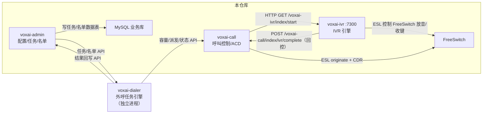

# 04 · 外部引擎接口约定（IVR / 外呼任务）

> 本文档梳理引擎与主系统之间的接口约定。其中 **IVR 引擎（voxai-ivr）** 和
> **外呼任务引擎（voxai-dialer）** 均在本仓库实现，但都是独立进程部署。
>
> 约定等级标注：
> - ✅ **已实现** —— 代码中真实存在、可直接对接收口。
> - 🚧 **已实现但默认关闭** —— 需要迁移、配置凭据和受控联调后启用。
> - ⚠️ **推断** —— 由数据表字段/注释代码反推，需与引擎侧确认。
> - ❌ **未约定** —— 本仓库无任何实现或线索，属缺口。

## 1. 总体数据流



## 2. IVR 引擎接口约定（已在本仓库实现）

### 2.1 服务发现与部署

- IVR 引擎为独立 Spring Boot 模块 `voxai-ivr`，端口 7300、context-path `/voxai-ivr`，`@MapperScan("com.voxai.core.mapper")`。
- 复用 `voxai-common` 抽取的 ESL 客户端（`com.voxai.core.esl`）连接 FreeSwitch 媒体服务器（`cc_station` 中 `application_type=4`）。
- `voxai-call` 通过 `TransferIvrHandler` 以 HTTP 拉起（`http://voxai-ivr:7300`，硬编码服务名）。

### 2.2 启动 IVR 流程 ✅

| 项 | 约定 |
| --- | --- |
| 方法 / 路径 | `GET http://voxai-ivr:7300/voxai-ivr/index/start` |
| 请求参数（Query） | `callId`（Long，通话唯一标识）、`deviceId`（String，被转 IVR 的 FreeSwitch channel UUID）、`ivrId`（Long，`cc_ivr_workflow.id`）、`mediaHost`（String，`host:port`，用于定位 FreeSwitch 连接） |
| 响应 | `String`（调用方不解析返回值，仅判断异常） |
| 超时 | `httpClient` Bean（`cc.inner.connectTimeout=100ms`、`cc.inner.readTimeout=3000ms`） |
| 调用方 | `TransferIvrHandler`（呼入路由 `routeType=3`、溢出 `overflowType=2` 时触发） |

代码位置：`voxai-call/.../cc/command/TransferIvrHandler.java`、`voxai-ivr/.../controller/IvrController.java`

```java
httpClient.getForEntity(
  "http://voxai-ivr:7300/voxai-ivr/index/start?callId={callId}&deviceId={deviceId}&ivrId={ivrId}&mediaHost={mediaHost}",
  String.class, params);
```

### 2.3 IVR 流程数据契约 ✅

IVR 引擎消费的流程定义在 `cc_ivr_workflow`：

| 字段 | 语义 | 说明 |
| --- | --- | --- |
| `id` | 流程 ID | 即 `ivrId` |
| `name` | 流程名称 | |
| `oss_id` | 流程文件名 | 流程文件（语音流程定义）所在存储标识 |
| `content` | 流程内容 | IVR 流程 JSON 节点图（见 2.6），引擎解析执行 |
| `init_params` | 启动参数描述 | IVR 启动所需参数的描述 |
| `voice_item` | 语音文件 id 列表 | 逗号分隔，流程用到的语音 |
| `type` | 1 转接 / 2 咨询 | |
| `status` | 1-5 | 待发布/审核中/审核未通过/审核通过/已上线 |

运行时轨迹落 `cc_ivr_flow`（`call_id`、`ivr_id`、`node_id`、`node_type`、`node_name`、`key_press`、`start_time`/`end_time`）——由 `voxai-ivr` 的 `IvrFlowService` 写入（`IvrFlowMapper.insertSelective`）。

### 2.4 健康检查 ✅

`GET /voxai-ivr/index/health` 返回 `up`（`IvrController.health`）。

### 2.5 IVR 结束回控 ✅

IVR 只做语音交互（放音/收键/按键分支），到达转接节点时回调 `voxai-call` 继续路由：

| 项 | 约定 |
| --- | --- |
| 方法 / 路径 | `POST /voxai-call/index/ivr/complete` |
| 请求体（JSON） | `{ "callId": Long, "deviceId": String, "transferType": String, "transferValue": String }`（`IvrCompleteVo`） |
| transferType | `group`（进技能组 ACD）/ `vdn` / `agent` / `hangup`（默认） |
| 处理 | `voxai-call` 的 `IvrCallbackController` 从缓存取 `CallInfo`/`DeviceInfo`，按 `transferType` 分发到 `groupHandler.hander` / `vdnHandler.hanlder` / `transferAgentHandler.hanlder` / `fsListen.hangupCall` |

### 2.6 IVR 流程 JSON 格式（`cc_ivr_workflow.content`）

```json
{
  "startNode": "n1",
  "nodes": [
    { "id": "n1", "type": "play", "file": "welcome.wav", "next": "n2" },
    { "id": "n2", "type": "input", "file": "menu.wav", "maxDigits": 1, "timeout": 5,
      "branches": [ { "key": "1", "next": "n3" }, { "key": "2", "next": "n4" } ],
      "default": "n2" },
    { "id": "n3", "type": "transfer", "targetType": "group", "targetValue": "1001" },
    { "id": "n4", "type": "transfer", "targetType": "hangup", "targetValue": "" }
  ]
}
```

节点类型：
- `play`：放音 `file`，结束转 `next`。
- `input`：放音 `file` 并收键（`maxDigits` 最大键长、`timeout` 超时秒），`branches[].key` 命中转对应 `next`，超时/无效转 `default`。
- `transfer`（结束节点）：`targetType ∈ {group, vdn, agent, hangup}`，`targetValue` 为目标 id / agentKey / 空。

## 3. 外呼任务引擎接口约定

完整业务说明见 [11-外呼任务](11-外呼任务.md) 和 [15-外部拨号引擎](15-外部拨号引擎.md)。

### 3.1 定位与部署 🚧

`voxai-dialer` 是仓库内的独立 Spring Boot 模块。它不直接连接 MySQL、Redis 或 FreeSWITCH，
通过 `voxai-admin` 的企业管理员认证接口管理任务、租约和结果，通过 `voxai-call` 的企业 Bearer
令牌接口查询容量、保留 `call_id`、发起客户优先呼叫和读取最终状态。`dialer.enabled=false` 为默认值，
不会自动拨号。

一个 worker 配置绑定一个企业；多个 worker 可共同轮询同一企业，数据库租约和 `call_id` 唯一约束负责去重。
启用前需完成 [拨号日志迁移](sql/migration_20261107_task_dialer.sql)，配置专用管理员账号、企业服务令牌、
呼叫节点地址和外显号码，并使用受控号码完成联调。

### 3.2 管理端接口 ✅

以下接口位于 `voxai-admin` 的 `/config` 路径下，使用绑定企业的管理员会话或专用 Basic 认证：

| 方法 | 路径 | 用途 |
| --- | --- | --- |
| `GET` | `/config/task/engine?afterId=0&limit=100` | 游标读取任务 |
| `GET` | `/config/task/{id}/attempt/active?afterAttemptId=&limit=100` | 恢复未完成 attempt |
| `GET` | `/config/task/{id}/engine/pending` | 查询未完成名单数量 |
| `POST` | `/config/task/{id}/claim` | 原子领取名单并创建租约 |
| `POST` | `/config/task/{id}/attempt/heartbeat` | 续租 |
| `POST` | `/config/task/{id}/attempt/result` | 校验话单并回写结果 |
| `POST` | `/config/task/{id}/command/{commandId}/ack` | 确认 start/resume/pause/close 命令 |

任务和名单接口始终按企业隔离。引擎必须保存 `attemptId`、`requestId`、`leaseToken`、`contactId`、
`leaseUntil` 和 `callId`，不能只保存自增任务 ID。

### 3.3 呼叫控制接口 ✅

以下接口位于 `voxai-call` 的 `/internal/dialer` 路径，必须同时发送 `Authorization: Bearer <企业令牌>`
和 `X-Company-Id`：

| 方法 | 路径 | 用途 |
| --- | --- | --- |
| `GET` | `/internal/dialer/task/{id}/capacity` | 计算任务、目标、企业剩余容量 |
| `POST` | `/internal/dialer/task/{id}/dial` | 校验租约并保留后发起客户腿 |
| `POST` | `/internal/dialer/task/{id}/status` | 查询最终主话单/客户腿状态 |

`dial` 和 `status` 请求体为 `{"attemptId":"...","leaseToken":"..."}`。服务端按租约和企业查询名单、
目标、外显和路由，禁止请求体改写企业或客户号码。`dial` 先在企业、任务、attempt 锁内持久化
`call_id`、媒体节点和 `dispatch_time`，再重新校验后调用 FreeSWITCH；同一 attempt 不重试 originate。

### 3.4 拨号策略与结果 ✅

- `cruise` 按任务并发和实际承接能力补位；IVR 只允许巡航模式。
- `predictive` 使用近一小时已完成拨打的接通率，样本不足 20 通或呼损超过 3% 时降为一名空闲坐席一路，
  默认最多放大到空闲坐席两倍。
- `busy`、`no_answer`、`failed` 在未达到 `call_rounds` 时按 `retry_interval` 重拨；`answered`、`rejected`、
  `invalid` 不重拨。客户接通但尚未桥接坐席也视为已接通，不重复拨打。
- FreeSWITCH 事件落 `cc_call_log`、`cc_call_device`、`cc_call_detail`；执行器读取最终主话单并通过
  `/attempt/result` 回写 `cc_task_contact`。

### 3.5 故障恢复与通知边界 ✅/⚠️

未分配 `call_id` 的过期租约可回收；已分配 `call_id` 的 attempt 不能因 worker 失联自动重拨。HTTP 超时、
FreeSWITCH 后台结果丢失或媒体失联时，执行器保留原 attempt，恢复后先查询话单和固定媒体节点。
媒体事件与补偿按 callId 串行，确认通道不存在后才补写失败话单。

`cc_company.notify_url` 沿用现有 CDR outbox 推送：V1 包含主话单和 `callDeviceList`，不包含流程明细；
V2 才增加 `callDetailList`。`status_notify`、`traffic_notify` 目前仍只有配置字段，没有接收端、签名、
重试和响应协议，属于待定义接口。

## 4. 附录：本仓库已实现的对外接口（相关集成面）

与两个引擎并列，以下是**真实存在、已实现**的对外接口，供引擎/第三方对接时复用：

### 4.1 CTI REST API（voxai-call）✅

代码注释中带编号（`5.x` 坐席侧 / `6.x` 管理侧），说明存在对应的外部 API 规范：

| 编号 | 方法 | 路径 | 说明 |
| --- | --- | --- | --- |
| 5.1.1 | POST | `/index/login` | 坐席登录（`AgentLoginVo`，返回 `AgentInfo`） |
| 5.2.1 | POST | `/cti/call/makeCall` | 发起呼叫（`MakeCallVo`） |
| 5.2.2 | POST | `/cti/call/hangup` | 挂断 |
| — | POST | `/cti/call/hold` / `cancelHold` | 保持 / 取消保持 |
| — | POST | `/cti/call/readyMute` / `cancelMute` | 静音 / 取消静音 |
| 6.1.1 | GET | `/cti/admin/call?callId=` | 查看话单 |
| 6.1.2 | GET | `/cti/admin/calling?callId=` | 查看通话中详情 |
| 6.2.1 | GET | `/cti/admin/agent/{agentKey}` | 查询坐席状态 |
| 6.2.2 | GET | `/cti/admin/group/{groupId}/ready` | 技能组空闲坐席 |
| — | GET | `/index/getcall?callId=` | 话单查询（无租户） |
| — | GET | `/index/health` | 健康检查 |

`MakeCallVo` 关键字段：`callType`（必填，`CallType` 枚举）、`called`（必填）、`caller`/`callerDisplay`/`calledDisplay`（可选，缺省用坐席/技能组配置）、`followData`（随路数据）、`uuid1`/`uuid2`。

### 4.2 坐席事件 WebHook ✅

坐席登录时传入 `webHook`（`AgentLoginVo.webHook`）。当坐席无 WebSocket 长连时，状态/通话事件以
`application/json` POST 到该地址（`WebSocketHandler` 第 331 行）。载荷为坐席事件 JSON。

### 4.3 话单推送（CDR Notify）✅

企业配置 `cc_company.notify_url`。通话结束后 POST 话单 JSON：

- 载荷：`CallLogPo`（`cc_call_log` 全字段 + `callDeviceList` 明细 + `caller`/`called`）。
- 头：`Content-Type: application/json`。
- 失败和待发送记录写入 `cc_cdr_notify`（`push_times`、`next_attempt_at`、租约和 `push_response`），由后台任务重试；同一 `call_id` 可能重复投递，接收方必须幂等。
- 默认 V1 只包含主话单和 `callDeviceList`；设置 `cdr.notify.version=2` 后增加 `callDetailList` 和明确的毫秒单位元数据。详见 [话单一致性与回调](10-话单一致性与回调.md)。

### 4.4 MQ（RabbitMQ，内部/异步）✅

| Exchange | Routing Key | Queue | 用途 |
| --- | --- | --- | --- |
| `CALL-LOG-EXCHANGE`（topic） | `DEVICE` / `DETAIL` / `CALLLOG` | `CALL-DEVICE-QUEUE` / `CALL-DETAIL-QUEUE` / `CALL-LOG-QUEUE` | CDR 落库异步化（`call.cdr.pressure=1` 时启用） |
| `AGENT-STATE-EXCHANGE`（topic） | `STATE` / `LOG` | `AGENT-STATE-QUEUE-{instanceId}` / `AGENT-LOG-QUEUE` | 坐席状态/日志同步 |
| `CC-CONFIG-EXCHANGE`（topic） | `""` | `CC-CONFIG-QUEUE-{instanceId}` | 配置变更通知 |

### 4.5 TCP 坐席状态订阅 ✅

`TcpServer` 提供第三方系统坐席状态订阅（登录/呼叫/应答/转接/放音事件），详见 [02-业务流程 §8](02-业务流程.md#8-坐席状态订阅tcp供第三方系统)。

## 5. 待补接口清单（缺口总结）

| 缺口 | 现状 | 建议 |
| --- | --- | --- |
| 外呼任务引擎回调（`status_notify`/`traffic_notify`） | ⚠️ 仅字段，无接收端 | 定义回调协议 + 主系统接收端点 |
| 多节点 ACD 队列接管 | ⚠️ ACD 队列仍在呼叫节点内存 | 持久化队列或提供节点故障转移协议 |
| 企业全局通道/CPS 配额 | ⚠️ 当前只约束拨号引擎任务呼叫 | 在统一呼叫入口实现覆盖手动外呼的原子配额 |
| 真实运营商联调 | ⚠️ 自动化测试使用 fake FreeSWITCH | 使用受控号码验证 SIP 接通、挂机、路由和最终话单 |

> IVR 引擎的「启动」「回控」「轨迹落库」已在 `voxai-ivr` 模块实现，不再列为缺口。
