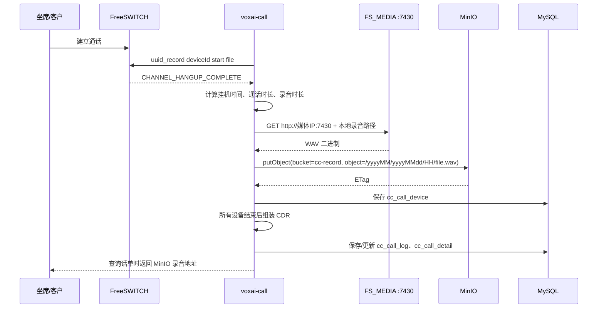

# 12 · 录音上传 MinIO 业务流程

## 1. 业务目标

通话结束后，系统将 FreeSWITCH 在媒体节点本地生成的 WAV 录音读取出来，上传到 MinIO 的 `cc-record` 桶，并把对象地址写入分机明细和主话单，供管理端查询和播放。

录音链路包含三个独立状态：

1. **FreeSWITCH 已生成本地录音**：录音文件存在 `record.path` 配置目录。
2. **MinIO 上传成功**：文件已写入 `cc-record` 桶，明细中的 `record` 已转换为 `/cc-record/...`。
3. **话单已落库**：所有设备挂机后，主话单、分机明细和流程轨迹完成持久化。

录音上传失败不会阻止当前设备明细继续落库，但当前实现不会自动重试，明细会保留本地录音路径，需要根据日志人工补传并修正录音地址；当前没有内置录音补偿流程。

## 2. 参与组件

| 组件 | 作用 | 开发环境配置 |
| --- | --- | --- |
| FreeSWITCH | 执行录音命令，生成 WAV 文件并发送 `CHANNEL_HANGUP_COMPLETE` 事件 | ESL `localhost:8022` |
| `voxai-call` | 根据技能组录音策略开始录音；挂机时下载、上传、落话单 | HTTP `7200`，WebSocket `7250` |
| FS_MEDIA | 通过 HTTP 提供 FreeSWITCH 本地录音文件 | `http://<媒体节点 IP>:7430` |
| MinIO | 持久化录音对象 | `http://localhost:9000`，桶 `cc-record` |
| MySQL | 保存 `cc_call_device` 分机录音地址和 `cc_call_log` 主录音地址 | 数据库 `voxai` |

`FS_MEDIA` 只负责读取文件，不负责上传；上传动作由 `voxai-call` 的 `FsHangupCompleteHandler` 执行。

## 3. 端到端流程



## 4. 录音何时开始

技能组字段 `cc_group.record_type` 控制录音策略：

| `record_type` | 业务含义 | 当前触发位置 |
| --- | --- | --- |
| `0` | 不录音 | 不发送 FreeSWITCH 录音命令 |
| `1` | 振铃录音 | 手动外呼在首侧应答、呼叫另一侧前开始；咨询应答分支也会开始一段录音。呼入和自动外呼在桥接成功后开始 |
| `2` | 接通录音 | 手动外呼、呼入和自动外呼在 `FsBridgeHandler` 桥接成功后开始 |

开始录音时，`BaseEventHandler.record` 会依次：

1. 设置采样率，默认 `8000Hz`。
2. 设置双声道录音。
3. 向 FreeSWITCH 发送 `uuid_record <deviceId> start <file>` 命令。

调用方随后把文件绝对路径写入运行时 `DeviceInfo.record`。开始录音日志表示已发送命令，仍需检查媒体节点上的实际文件。

开发环境默认配置：

```properties
record.path=/Users/dongjb/soft/freeswitch/
fs.record.file=wav
fs.sample.rate=8000
```

文件名格式为：

```text
{record.path}{yyyyMMdd}/{callId}_{deviceId}_{epochSecond}.{fs.record.file}
```

示例：

```text
/Users/dongjb/soft/freeswitch/20260717/866009751568252928_4488361488372387_1784280814.wav
```

## 5. 挂机上传步骤

`CHANNEL_HANGUP_COMPLETE` 到达后，系统按设备逐条处理：

### 5.1 计算设备结束信息

系统从缓存中的 `CallInfo` 找到设备，写入：

- `end_time`：FreeSWITCH 事件时间；
- `hangup_cause`、SIP 状态、SIP 协议、通道名；
- `talk_time`：应答时间到挂机时间；
- `record_time`：录音开始时间到挂机时间。

### 5.2 通过 7430 读取 WAV

只有 `DeviceInfo.record` 非空时才会上传。系统拼接：

```text
http://{event.localMediaIp}:7430{DeviceInfo.record}
```

因此媒体服务必须能访问录音文件，并且 URL 的路径必须与 `record.path` 生成的路径一致。以开发环境为例：

```bash
curl -I \
  'http://172.20.10.5:7430/Users/dongjb/soft/freeswitch/20260717/866009751568252928_4488361488372387_1784280814.wav'
```

应从 `voxai-call` 所在主机验证：HEAD 返回 `200` 可确认路径响应，实际下载还需 GET 成功并取得有效音频；`404` 通常表示路径映射或文件名不一致，连接失败通常表示 7430 服务未启动或网络不可达。

该下载使用 `restTemplate`，连接超时默认 `100ms`、读取超时默认 `300ms`，对应配置 `cdr.notify.connectTimeout` 和 `cdr.notify.readTimeout`。长录音或跨节点访问可能需要调整；这两个配置也影响共享该客户端的调用。

### 5.3 写入 MinIO

系统读取 WAV 二进制后调用 MinIO `putObject`：

```text
bucket: cc-record
object: /{yyyyMM}/{yyyyMMdd}/{HH}/{原文件名}
```

日期目录使用上传时服务器当前时间。例如，文件名为 `call_device.wav`，上传对象可能是：

```text
/202607/20260717/17/call_device.wav
```

上传成功后，运行时 `DeviceInfo.record` 从本地绝对路径改为：

```text
/cc-record/202607/20260717/17/call_device.wav
```

MinIO 开发环境端点位于 `voxai-call/src/main/resources/application-dev.properties`：

```properties
voxai.minio.endpoint=http://localhost:9000
```

AccessKey 和 SecretKey 使用部署环境配置，不在业务文档中展开。`cc-record` 桶必须预先存在，且运行账号必须具备对象写入权限。

### 5.4 保存分机明细

上传步骤结束后，系统复制 `DeviceInfo` 到 `cc_call_device` 并保存。明细的 `record` 可能是：

- `/cc-record/...`：MinIO 上传成功；
- 原始本地绝对路径：录音读取或 MinIO 上传失败。

上传异常会记录 `url:...` 和异常堆栈，但不会抛出并中断当前明细保存。

### 5.5 组装主话单

最后一个设备挂机后，系统组装 CDR，完成以下动作：

1. 汇总所有设备明细和流程轨迹。
2. 选择最早开始且有录音地址的设备作为主话单 `cc_call_log.record`。
3. 保存或更新 `cc_call_log`、`cc_call_detail` 及相关月表数据。
4. 如企业配置了 `notify_url`，提交话单通知。
5. 清理坐席通话状态和 Redis 中的 `CallInfo`。

主话单有 `record` 值并不表示上传成功：组装器只检查地址非空，因此最早的录音设备上传失败时，本地路径也可能进入主话单。应结合地址格式和 MinIO 中的对象核验结果。

## 6. 关键数据字段

| 数据位置 | 字段 | 含义 |
| --- | --- | --- |
| `cc_group` | `record_type` | 技能组录音策略：0 不录音、1 振铃录音、2 接通录音 |
| `cc_call_device` | `record` | 当前设备录音地址，成功时为 `/cc-record/...` |
| `cc_call_device` | `record_start_time` | 录音开始时间（毫秒） |
| `cc_call_device` | `record_time` | 录音时长（毫秒） |
| `cc_call_log` | `record` | 主话单录音地址，取最早有录音地址的设备 |
| `cc_call_log` | `record_time` | 主话单录音时长 |
| `cc_company` | `record_storage` | 企业录音保留月数配置；当前上传代码不在挂机流程中执行清理 |

## 7. 部署与联调检查

### 7.1 服务检查

```bash
# FreeSWITCH ESL
fs_cli -x 'show calls count'

# FS_MEDIA
lsof -nP -iTCP:7430 -sTCP:LISTEN
curl -I 'http://<媒体节点 IP>:7430/<录音文件路径>'

# MinIO
curl -fsS http://127.0.0.1:9000/minio/health/live
```

本地可用 Nginx 或其他静态 HTTP 服务监听 `7430`，将 URL 路径映射到 `record.path` 对应目录。媒体服务的监听地址必须覆盖 `event.localMediaIp`，不能只监听一个其他节点无法访问的回环地址。

### 7.2 一次完整联调

1. 确认坐席 SIP 已注册，FreeSWITCH 能看到坐席分机。
2. 确认目标号码可呼叫，技能组 `record_type` 设置为 `1` 或 `2`。
3. 启动 `voxai-call`、FS_MEDIA 和 MinIO。
4. 完成一通通话后正常挂机。
5. 在 `voxai-call` 日志中依次查找：
   - `开始录音`；
   - `callId ... deviceId ...` 的挂机明细；
   - `get record file`；
   - `record fileName` 和 `minioTag`。
6. 查询 `cc_call_device.record` 和 `cc_call_log.record`，确认值为 `/cc-record/...`。
7. 用 MinIO 客户端或对象管理界面确认 `cc-record` 中存在对应对象并可读取。

## 8. 异常定位

| 现象 | 优先检查 | 说明 |
| --- | --- | --- |
| 没有 WAV 文件 | `record_type`、`开始录音`日志、FreeSWITCH 录音命令 | 录音策略为 0 或录音命令未执行 |
| WAV 存在但上传日志没有 `get record file` | `event.localMediaIp`、7430 监听、URL 路径映射 | `voxai-call` 无法通过 FS_MEDIA 读取 |
| 7430 返回 404 | `record.path` 与静态服务 root/alias | URL 使用的是录音绝对路径，映射必须保持一致 |
| MinIO 连接失败 | endpoint、网络、凭据 | 检查 MinIO 健康接口和服务日志 |
| MinIO 返回桶不存在/无权限 | `cc-record` 桶、AccessKey 权限 | 需先创建桶并授权写入 |
| `cc_call_device.record` 仍是本地路径 | 查看 `FsHangupCompleteHandler` 异常日志 | 当前实现失败后继续落库，不自动重试 |
| 主话单没有录音 | 先检查设备明细，再检查最后一个设备挂机和 CDR 组装 | 主话单从设备明细中选择最早录音地址 |
| 录音已上传但前端无法播放 | 检查前端播放地址拼接、反向代理和对象访问权限 | 数据库存的是 `/cc-record/...`，可播放地址由访问层提供 |

## 9. 当前实现边界

- 上传发生在设备挂机事件处理线程中，属于同步上传。
- 上传失败没有内置重试队列，原始本地文件不会被自动删除。
- 上传对象的目录日期取上传时刻，不取录音开始时刻。
- `record_storage` 已作为企业配置字段存在，但当前挂机上传流程未实现按保留月数自动清理 MinIO 对象。
- 主话单只保留一个主 `record` 地址；转接、咨询等多设备录音仍以 `cc_call_device` 明细为准。
- 业务文档描述的是当前代码行为，部署环境若改变 FS_MEDIA、MinIO 或访问代理，需要同步修改配置和联调检查项。

## 10. 代码定位

- 录音命令：`voxai-call/src/main/java/com/voxai/cc/fs/handler/base/BaseEventHandler.java`
- 振铃录音触发：`voxai-call/src/main/java/com/voxai/cc/fs/handler/FsAnswerHandler.java`
- 接通录音触发：`voxai-call/src/main/java/com/voxai/cc/fs/handler/FsBridgeHandler.java`
- 下载、上传和设备落库：`voxai-call/src/main/java/com/voxai/cc/fs/handler/FsHangupCompleteHandler.java`
- 主话单组装：`voxai-call/src/main/java/com/voxai/cc/cdr/CdrAssembler.java`
- 录音和 MinIO 开发配置：`voxai-call/src/main/resources/application-dev.properties`
