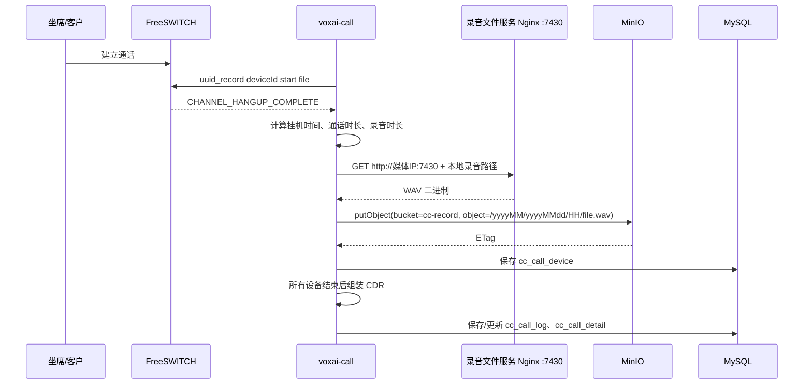

# 12 · 录音上传 MinIO 业务流程

## 1. 业务目标

通话结束后，系统将 FreeSWITCH 在媒体节点本地生成的 WAV 录音读取出来，上传到 MinIO 的 `cc-record` 桶，并把对象地址写入分机明细和主话单，供管理端查询和播放。

录音链路包含三个独立状态：

1. **FreeSWITCH 已生成本地录音**：录音文件存在 `record.path` 配置目录。
2. **MinIO 上传成功**：文件已写入 `cc-record` 桶，明细中的 `record` 已转换为 `/cc-record/...`。
3. **话单已落库**：所有设备挂机后，主话单、分机明细和流程轨迹完成持久化。

录音上传失败不会阻止当前设备明细继续落库，但当前实现不会自动重试，明细会保留本地录音路径，需要根据日志人工补传并修正录音地址；当前没有内置录音补偿流程。

## 2. 参与组件

| 组件 | 作用 | 开发环境配置 |
| --- | --- | --- |
| FreeSWITCH | 执行录音命令，生成 WAV 文件并发送 `CHANNEL_HANGUP_COMPLETE` 事件 | ESL `localhost:8022` |
| `voxai-call` | 根据技能组录音策略开始录音；挂机时下载、上传、落话单 | HTTP `7200`，WebSocket `7250` |
| 录音文件服务（Nginx） | 通过 HTTP 提供 FreeSWITCH 本地 WAV，供 `voxai-call` 下载 | `http://<媒体节点 IP>:7430` |
| MinIO | 持久化录音对象 | `http://localhost:9000`，桶 `cc-record` |
| `voxai-admin` | 校验当前企业的话单权限，签发 MinIO 临时播放地址 | `GET /voxai-admin/config/callRecording/{callId}` |
| MySQL | 保存 `cc_call_device` 分机录音地址和 `cc_call_log` 主录音地址 | 数据库 `voxai` |

录音文件服务只负责通过 HTTP 读取文件；上传动作由 `voxai-call` 的 `FsHangupCompleteHandler` 执行。FreeSWITCH 负责通话媒体处理并生成录音，Nginx 在 7430 提供挂机上传链路所需的文件读取。浏览器播放走管理端鉴权和 MinIO 临时地址。

代码中的枚举名称为 `StationType.RECORDING_FILE_SERVICE`，保留历史数值 `4`；文档统一使用“录音文件服务（Nginx）”这一名称。当前 FreeSWITCH ESL 节点查询也使用硬编码 `applicationType=4`，本次名称调整不改变这些查询。7430 下载地址由事件中的媒体 IP 和本地录音路径拼接，不通过该枚举发现 Nginx。

## 3. 端到端流程



报表播放流程见 §5.6：浏览器通过 `voxai-admin` 获取临时地址后直接向 MinIO 读取音频。

## 4. 录音何时开始

技能组字段 `cc_group.record_type` 控制录音策略：

| `record_type` | 业务含义 | 当前触发位置 |
| --- | --- | --- |
| `0` | 不录音 | 不发送 FreeSWITCH 录音命令 |
| `1` | 振铃录音 | 手动外呼在首侧应答、呼叫另一侧前开始；咨询应答分支也会开始一段录音。呼入和自动外呼在桥接成功后开始 |
| `2` | 接通录音 | 手动外呼、呼入和自动外呼在 `FsBridgeHandler` 桥接成功后开始 |

开始录音时，`BaseEventHandler.record` 会依次：

1. 设置采样率，默认 `8000Hz`。
2. 设置双声道录音。
3. 向 FreeSWITCH 发送 `uuid_record <deviceId> start <file>` 命令。

调用方负责记录文件绝对路径和开始时间。桥接录音分支（包括呼入、自动外呼）会先写入 `DeviceInfo.record`、`recordStartTime` 并保存到 Redis，再发送录音命令，确保后续录音事件和挂机处理能取到路径。开始录音日志表示已发送命令，仍需检查媒体节点上的实际文件。

开发环境默认配置：

```properties
record.path=/Users/dongjb/soft/freeswitch/
fs.record.file=wav
fs.sample.rate=8000
```

文件名格式为：

```text
{record.path}{yyyyMMdd}/{callId}_{deviceId}_{epochSecond}.{fs.record.file}
```

示例：

```text
/Users/dongjb/soft/freeswitch/20260717/866009751568252928_4488361488372387_1784280814.wav
```

## 5. 挂机上传步骤

`CHANNEL_HANGUP_COMPLETE` 到达后，系统按设备逐条处理：

### 5.1 计算设备结束信息

系统从缓存中的 `CallInfo` 找到设备，写入：

- `end_time`：FreeSWITCH 事件时间；
- `hangup_cause`、SIP 状态、SIP 协议、通道名；
- `talk_time`：应答时间到挂机时间；
- `record_time`：录音开始时间到挂机时间。

### 5.2 通过 7430 读取 WAV

只有 `DeviceInfo.record` 非空时才会上传。系统拼接：

```text
http://{event.localMediaIp}:7430{DeviceInfo.record}
```

因此录音文件服务必须能访问录音文件，并且 URL 的路径必须与 `record.path` 生成的路径一致。以开发环境为例：

```bash
curl -I \
  'http://172.20.10.5:7430/Users/dongjb/soft/freeswitch/20260717/866009751568252928_4488361488372387_1784280814.wav'
```

应从 `voxai-call` 所在主机验证：HEAD 返回 `200` 可确认路径响应，实际下载还需 GET 成功并取得有效音频；`404` 通常表示路径映射或文件名不一致，连接失败通常表示 7430 服务未启动或网络不可达。

`event.localMediaIp` 是下载 URL 的目标媒体节点 IP；Nginx `allow` 检查的是请求来源 IP，即 `voxai-call` 访问媒体节点时的出口地址（跨容器或 NAT 时可能被转换）。两者应分别核对。

该下载使用 `restTemplate`，连接超时默认 `100ms`、读取超时默认 `300ms`，对应配置 `cdr.notify.connectTimeout` 和 `cdr.notify.readTimeout`。长录音或跨节点访问可能需要调整；这两个配置也影响共享该客户端的调用。

### 5.3 写入 MinIO

系统读取 WAV 二进制后调用 MinIO `putObject`：

```text
bucket: cc-record
object: /{yyyyMM}/{yyyyMMdd}/{HH}/{原文件名}
```

日期目录使用上传时服务器当前时间。例如，文件名为 `call_device.wav`，上传对象可能是：

```text
/202607/20260717/17/call_device.wav
```

上传成功后，运行时 `DeviceInfo.record` 从本地绝对路径改为：

```text
/cc-record/202607/20260717/17/call_device.wav
```

MinIO 开发环境端点位于 `voxai-call/src/main/resources/application-dev.properties`：

```properties
voxai.minio.endpoint=http://localhost:9000
```

AccessKey 和 SecretKey 使用部署环境配置，不在业务文档中展开。`cc-record` 桶必须预先存在，且运行账号必须具备对象写入权限。

### 5.4 保存分机明细

上传步骤结束后，系统复制 `DeviceInfo` 到 `cc_call_device` 并保存。明细的 `record` 可能是：

- `/cc-record/...`：MinIO 上传成功；
- 原始本地绝对路径：录音读取或 MinIO 上传失败。

上传异常会记录 `url:...` 和异常堆栈，但不会抛出并中断当前明细保存。

### 5.5 组装主话单

最后一个设备挂机后，系统组装 CDR，完成以下动作：

1. 汇总所有设备明细和流程轨迹。
2. 选择最早开始且有录音地址的设备作为主话单 `cc_call_log.record`。
3. 保存或更新 `cc_call_log`、`cc_call_detail` 及相关月表数据。
4. 如企业配置了 `notify_url`，提交话单通知。
5. 清理坐席通话状态和 Redis 中的 `CallInfo`。

主话单有 `record` 值并不表示上传成功：组装器只检查地址非空，因此最早的录音设备上传失败时，本地路径也可能进入主话单。应结合地址格式和 MinIO 中的对象核验结果。

### 5.6 报表播放录音

呼入、外呼报表共用录音弹窗，打开时携带登录凭证请求 `GET /voxai-admin/config/callRecording/{callId}`。管理端按当前绑定企业查询主话单，校验录音地址以 `/cc-record/` 开头且 MinIO 对象存在，再返回有效期 **300 秒**的签名 GET 地址（成功响应 `code=0`，`data` 为 URL）。无可用录音时返回“录音文件暂不可用”。

浏览器使用该地址直接读取 MinIO 音频，桶可以保持私有。`voxai-admin` 使用的 MinIO endpoint 必须能被浏览器访问；远程用户无法通过 `localhost:9000` 访问开发机 MinIO。若页面使用 HTTPS，也需提供浏览器可访问的 HTTPS 对象存储入口，并在签发地址前正确配置 endpoint，避免修改签名 URL 导致校验失败。地址过期后重新打开录音弹窗获取新地址。

## 6. 关键数据字段

| 数据位置 | 字段 | 含义 |
| --- | --- | --- |
| `cc_group` | `record_type` | 技能组录音策略：0 不录音、1 振铃录音、2 接通录音 |
| `cc_call_device` | `record` | 当前设备录音地址，成功时为 `/cc-record/...` |
| `cc_call_device` | `record_start_time` | 录音开始时间（毫秒） |
| `cc_call_device` | `record_time` | 录音时长（毫秒） |
| `cc_call_log` | `record` | 主话单录音地址，取最早有录音地址的设备 |
| `cc_call_log` | `record_time` | 主话单录音时长 |
| `cc_company` | `record_storage` | 企业录音保留月数配置；当前上传代码不在挂机流程中执行清理 |

## 7. 部署与联调检查

### 7.1 服务检查

```bash
# FreeSWITCH ESL
fs_cli -x 'show calls count'

# 录音文件服务（Nginx）
lsof -nP -iTCP:7430 -sTCP:LISTEN
curl -I 'http://<媒体节点 IP>:7430/<录音文件路径>'

# MinIO
curl -fsS http://127.0.0.1:9000/minio/health/live
```

本地可用 Nginx 或其他静态 HTTP 服务监听 `7430`，将 URL 路径映射到 `record.path` 对应目录。录音文件服务的监听地址必须覆盖 `event.localMediaIp`，不能只监听一个其他节点无法访问的回环地址。

#### 本机 Nginx 配置与启动

开发机使用 `/Users/dongjb/soft/nginx/freeswitch-recording.conf` 配置录音文件服务。配置通过精确的 URL 路径映射读取 FreeSWITCH 本地 WAV：

```nginx
pid /Users/dongjb/soft/nginx/freeswitch-recording.pid;
error_log /Users/dongjb/soft/nginx/freeswitch-recording-error.log;

events {}

http {
    access_log off;

    server {
        listen 7430;

        # 允许 voxai-call 请求的实际来源 IP；以下为开发机示例。
        allow 127.0.0.1;
        allow ::1;
        allow 172.20.10.5;
        deny all;

        # /Users/dongjb/soft/freeswitch/<日期>/<文件名>.wav
        # 映射到同一路径下的 FreeSWITCH 录音文件。
        location ~ ^/Users/dongjb/soft/freeswitch/([0-9]+/[^/]+\.wav)$ {
            alias /Users/dongjb/soft/freeswitch/$1;
            default_type audio/wav;
        }

        location / {
            return 404;
        }
    }
}
```

Nginx 可执行文件通过 Homebrew 安装（本机为 `/opt/homebrew/bin/nginx`）。配置文件和启动脚本均位于仓库外，不会随 Maven 构建自动安装。启动脚本 `/Users/dongjb/soft/shell/nginx.sh` 检查可执行文件和配置文件后，若发现任何 `nginx` 进程就直接退出；没有进程时才检查配置语法并启动：

```bash
# 启动（若已有 nginx 进程，脚本提示已运行并退出）
/Users/dongjb/soft/shell/nginx.sh

# 单独验证配置
/opt/homebrew/bin/nginx -t -c /Users/dongjb/soft/nginx/freeswitch-recording.conf

# 确认该独立配置的主进程（配置已启动时执行）
ps -p "$(cat /Users/dongjb/soft/nginx/freeswitch-recording.pid)" -o pid=,command=

# 修改配置后重载
/opt/homebrew/bin/nginx -s reload -c /Users/dongjb/soft/nginx/freeswitch-recording.conf

# 优雅停止
/opt/homebrew/bin/nginx -s quit -c /Users/dongjb/soft/nginx/freeswitch-recording.conf

# 检查端口及错误日志
lsof -nP -iTCP:7430 -sTCP:LISTEN
tail -f /Users/dongjb/soft/nginx/freeswitch-recording-error.log
```

脚本提示 `nginx is already running` 不能证明 7430 已启动：其他用途的 Nginx 也会触发此提示。应结合 PID、进程命令和 `lsof` 确认本配置的监听；若只有其他 Nginx 实例，先检查配置，再用 `/opt/homebrew/bin/nginx -c /Users/dongjb/soft/nginx/freeswitch-recording.conf` 启动此独立实例。

`allow` 白名单应包含 `voxai-call` 的实际请求来源 IP，否则返回 `403`。录音路径正则、`alias` 根目录和 FreeSWITCH 的 `record.path` 必须对应；此正则仅匹配一层数字日期目录下的 `.wav`，更换目录结构或 `fs.record.file` 时需同步修改。Nginx 运行用户还需有目录遍历和文件读取权限。部署到其他主机时，应替换配置中的绝对路径、PID/日志路径和来源 IP。

容器部署时，Nginx 必须能在容器内读到同一份录音文件，并将 URL 中的绝对路径映射到实际挂载目录。容器入口执行 `nginx start` 并不代表已加载此 7430 配置；还需核对配置挂载、端口发布或 host 网络，以及从 `voxai-call` 到 `event.localMediaIp:7430` 的连通性。

#### 验收文件读取

从 `voxai-call` 所在主机或容器执行，使用媒体节点上已存在的 WAV 的完整路径。以下值需要替换，`RECORD_PATH` 以 `/` 开头，不要额外添加一层目录：

```bash
MEDIA_IP=172.20.10.5
RECORD_PATH=/Users/dongjb/soft/freeswitch/20260717/call_device.wav
RECORD_URL="http://${MEDIA_IP}:7430${RECORD_PATH}"
RECORD_CHECK_DIR="$(mktemp -d /tmp/recording-check.XXXXXX)"

# 预期 200、audio/wav；完整 GET 成功才证明文件可下载
curl -fsSI "$RECORD_URL"
curl -fS "$RECORD_URL" -o "$RECORD_CHECK_DIR/record.wav"
file "$RECORD_CHECK_DIR/record.wav"

# 预期 206 和 Content-Range: bytes 0-43/总字节数
curl -fS -D - -H 'Range: bytes=0-43' "$RECORD_URL" -o "$RECORD_CHECK_DIR/header.bin"

# 未映射路径预期 404（从白名单允许的来源访问）
curl -sS -o /dev/null -w '%{http_code}\n' "http://${MEDIA_IP}:7430/"
```

`file` 应识别为 RIFF/WAVE 音频；必要时用音频工具确认时长和内容。临时文件位于 `$RECORD_CHECK_DIR`，验收后按本地录音保留要求清理。这里的 Range 检查验证 Nginx 文件服务；前端播放仍需单独验证 MinIO 签名地址。

### 7.2 一次完整联调

1. 确认坐席 SIP 已注册，FreeSWITCH 能看到坐席分机。
2. 确认目标号码可呼叫，技能组 `record_type` 设置为 `1` 或 `2`。
3. 启动 `voxai-call`、录音文件服务（Nginx）和 MinIO。
4. 完成一通通话后正常挂机。
5. 在 `voxai-call` 日志中依次查找：
   - `开始录音`；
   - `callId ... deviceId ...` 的挂机明细；
   - `get record file`；
   - `record fileName` 和 `minioTag`。
6. 查询 `cc_call_device.record` 和 `cc_call_log.record`，确认值为 `/cc-record/...`。
7. 用 MinIO 客户端或对象管理界面确认 `cc-record` 中存在对应对象并可读取。
8. 登录呼入或外呼报表，打开录音弹窗，确认临时地址接口成功、音频可播放且可拖动进度；刷新页面后重新打开也应可用。

## 8. 异常定位

| 现象 | 优先检查 | 说明 |
| --- | --- | --- |
| 没有 WAV 文件 | `record_type`、`开始录音`日志、FreeSWITCH 录音命令 | 录音策略为 0 或录音命令未执行 |
| WAV 存在但没有 `get record file` | 先检查缓存中的 `DeviceInfo.record`，再检查 `url:` 异常、7430 和路径映射 | 路径为空不会尝试下载；此日志在 GET 成功后才打印。旧版本呼入录音路径未写入缓存也可能导致跳过上传 |
| 7430 拒绝连接或超时 | `lsof`、Nginx PID/配置、目标媒体 IP、网络和下载超时配置 | “已有 nginx 进程”不代表正在监听 7430；需从 `voxai-call` 的实际运行环境验证 |
| 7430 返回 403 | 请求来源 IP 白名单、目录和文件权限、Nginx error.log | `allow` 匹配来源地址；权限不足也可能返回 403，按日志区分 |
| 7430 返回 404 | `record.path` 与静态服务 root/alias | URL 使用的是录音绝对路径，映射必须保持一致 |
| MinIO 连接失败 | endpoint、网络、凭据 | 检查 MinIO 健康接口和服务日志 |
| MinIO 返回桶不存在/无权限 | `cc-record` 桶、AccessKey 权限 | 需先创建桶并授权写入 |
| `cc_call_device.record` 仍是本地路径 | 查看 `FsHangupCompleteHandler` 异常日志 | 当前实现失败后继续落库，不自动重试 |
| 主话单没有录音 | 先检查设备明细，再检查最后一个设备挂机和 CDR 组装 | 主话单从设备明细中选择最早录音地址 |
| 录音已上传但临时地址接口不可用 | `voxai-admin` 是否已部署并重启、登录企业、主话单地址和对象是否存在 | 接口按当前企业查主话单；返回“录音文件暂不可用”时先核对这些条件 |
| 播放请求仍直接访问前端 `/cc-record/...` 并返回 404 | 前端是否已更新、录音弹窗请求链路 | 应先请求管理端临时地址接口，再访问 MinIO 签名 URL |
| 签名 URL 无法访问或返回 403 | 浏览器到 MinIO endpoint 的网络、HTTPS、签名有效期和 URL 是否被改写 | 私有桶通过有效签名读取，无需开放公共访问；过期后重新打开弹窗 |

## 9. 当前实现边界

- 上传发生在设备挂机事件处理线程中，属于同步上传。
- 上传失败没有内置重试队列，原始本地文件不会被自动删除。
- 上传对象的目录日期取上传时刻，不取录音开始时刻。
- `record_storage` 已作为企业配置字段存在，但当前挂机上传流程未实现按保留月数自动清理 MinIO 对象。
- 主话单只保留一个主 `record` 地址；转接、咨询等多设备录音仍以 `cc_call_device` 明细为准。
- 业务文档描述的是当前代码行为，部署环境若改变录音文件服务、MinIO 或访问代理，需要同步修改配置和联调检查项。

## 10. 代码定位

- 录音命令：`voxai-call/src/main/java/com/voxai/cc/fs/handler/base/BaseEventHandler.java`
- 振铃录音触发：`voxai-call/src/main/java/com/voxai/cc/fs/handler/FsAnswerHandler.java`
- 接通录音触发：`voxai-call/src/main/java/com/voxai/cc/fs/handler/FsBridgeHandler.java`
- 下载、上传和设备落库：`voxai-call/src/main/java/com/voxai/cc/fs/handler/FsHangupCompleteHandler.java`
- 主话单组装：`voxai-call/src/main/java/com/voxai/cc/cdr/CdrAssembler.java`
- 临时播放地址：`voxai-admin/src/main/java/com/voxai/api/web/CallRecordingController.java`
- 报表录音弹窗：独立前端项目 `ai-call-center-web/src/components/CallReportDialogs.vue`
- 录音和 MinIO 开发配置：`voxai-call/src/main/resources/application-dev.properties`
