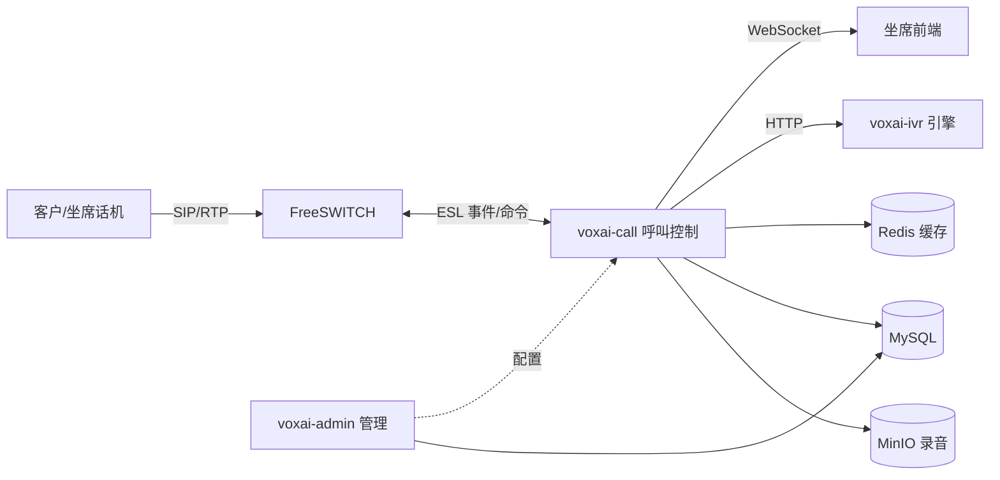
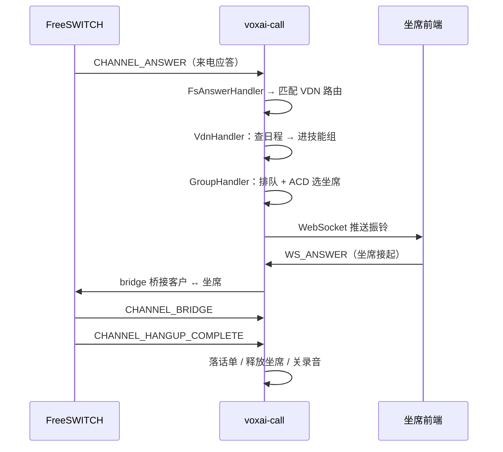

# 用 Java + FreeSWITCH 从零构建企业级 AI 呼叫中心：架构、事件驱动设计与踩坑实战

> 呼叫中心看似离多数后端同学很远，但它本质上就是一个「**高并发的实时状态机 + 媒体编排系统**」。
> 本文以一个真实落地的开源项目为例，讲清楚 Java 微服务如何驾驭 FreeSWITCH，把呼入、排队、ACD 分配、
> 坐席通话、IVR、话单这一整条链路串起来，并分享几个只有真正跑起来才会踩到的坑。

---

## 一、为什么是 FreeSWITCH

做呼叫中心，最核心的诉求有三点：

1. **媒体处理**：接电话、放音、收按键、录音、桥接、转接、会议；
2. **路由与排队**：把来电按规则送到正确的技能组、坐席或 IVR；
3. **可编程性**：业务逻辑（租户、坐席、策略、话单）必须能被应用层完全控制。

FreeSWITCH 是一个开源的软交换（SoftSwitch），在语音/视频媒体处理上非常成熟，更重要的是它提供了一套
**ESL（Event Socket Library）**：应用可以通过 TCP 连接到 FreeSWITCH，订阅事件、下发命令（`originate`、
`bridge`、`playback`、`play_and_get_digits` 等）。这让「业务在 Java、媒体在 FreeSWITCH」的分工变得清晰。

所以我们采用的方案是：

- **Java 侧（Spring Boot 微服务）** 承载所有业务：多租户、坐席/技能组/技能、路由规则、ACD 算法、IVR 编排、话单统计；
- **FreeSWITCH 侧** 只负责媒体：接续、放音、录音、桥接，做一个「听话的媒体执行器」。

---

## 二、整体架构

项目拆成四个后端模块 + 一个前端：

| 模块 | 端口 | 职责 |
| --- | --- | --- |
| `voxai-common` | — | 公共库：实体、MyBatis Mapper、枚举、PO/VO、策略接口 |
| `voxai-admin` | 7100 | 管理 API：企业/坐席/技能组/技能/VDN/IVR/溢出/话单 CRUD，Quartz 定时统计 |
| `voxai-call` | 7200 | 呼叫控制：ESL 事件接入、ACD 路由、WebSocket 实时通信、TCP 状态订阅 |
| `voxai-ivr` | 7300 | IVR 引擎：放音/收键/按键分支，结束后回控 `voxai-call` |
| `ai-call-center-web` | 3000 | Vue3 + Element Plus + JsSIP 软电话坐席前端（独立仓库） |

技术栈：Spring Boot 2.3 + Spring Cloud（Nacos）+ MyBatis + Redis + RabbitMQ（可选 Kafka）+ MinIO + FreeSWITCH。



这篇文章的重点放在 `voxai-call` 这个「大脑」上——它是最难、也最有意思的部分。

---

## 三、核心设计之一：与 FreeSWITCH 的连接（ESL）

`voxai-call` 通过 **ESL inbound 模式**连接 FreeSWITCH：由应用主动连接 FreeSWITCH 的 ESL 端口，订阅全部事件，
再根据事件驱动业务流转。

连接不是写死一个 IP，而是**从数据库动态发现**：`station` 表里登记了所有 FreeSWITCH 节点（含连接密码），
启动时逐个连接，并维护一个「每台 FreeSWITCH 一个 ESL Client」的连接池。

```java
@Component
public class FsListen {
    // 每个 FreeSWITCH 节点一个 ESL 客户端
    private Map<String, Client> fsClient = new HashMap<>();
    // 线程组：见第四部分
    private Map<Integer, ThreadPoolExecutor> executorMap = new ConcurrentHashMap<>();

    public void start() {
        // 1. 初始化固定线程池
        for (int i = 0; i < threadNum; i++) {
            executorMap.put(i, new ThreadPoolExecutor(1, 1, 0L, TimeUnit.MILLISECONDS,
                    new LinkedBlockingQueue<>(), new ThreadFactoryBuilder().setNameFormat("fs-pool-" + i).build()));
        }
        // 2. 从 station 表发现 FreeSWITCH 并连接
        for (Station station : stationMapper.selectListByMap(...)) {
            if (station.getStatus() == 1) {
                connect(station.getApplicationHost(), station.getApplicationPort(), station.getPwd());
            }
        }
        // 3. 定时巡检：新增节点连接、下线节点断开、死链重连
        checkFsThread.scheduleAtFixedRate(this::checkConnect, 2, 1, TimeUnit.MINUTES);
    }
}
```

连接建立后，**订阅 `all` 事件**，并对事件做一次「噪音过滤」——FreeSWITCH 会推大量我们并不关心的事件
（`HEARTBEAT`、`CODEC`、`RECV_INFO` 等），先 `switch` 掉，只放行业务相关的事件（`CHANNEL_ANSWER`、
`CHANNEL_BRIDGE`、`CHANNEL_HANGUP_COMPLETE`、`PLAYBACK_STOP`、`DTMF`……）。

```java
client.setEventSubscriptions(IModEslApi.EventFormat.PLAIN, "all");
IEslEventListener listener = new IEslEventListener() {
    @Override
    public void onEslEvent(Context ctx, EslEvent event) {
        String eventName = event.getEventName();
        switch (eventName) {
            case FsConstant.HEARTBEAT:   // 忽略噪音事件
            case FsConstant.CODEC:
            case FsConstant.RECV_INFO:
                return;
            // ... 其他需要的事件走 break 继续处理
        }
        // 把 ESL 事件头 JSON 反序列化成强类型 Java 事件对象
        FsBaseEvent formatEvent = formatEvent(ctx, event, eventName);
        // 分发到线程池
        ...
    }
};
client.addEventListener(listener);
```

这里有个关键设计：**事件名 → Java 事件类**的映射通过枚举 `EventType` 维护。

```java
public enum EventType {
    CHANNEL_ANSWER(1005, FsAnswerEvent.class),
    CHANNEL_BRIDGE(1010, FsBridgeEvent.class),
    CHANNEL_HANGUP_COMPLETE(1016, FsHangupCompleteEvent.class),
    PLAYBACK_STOP(1009, FsPlaybackStopEvent.class),
    DTMF(1012, FsDtmfEvent.class),
    ...
    public static Class getClassByCmd(String cmd) { return classMap.get(cmd); }
}
```

ESL 事件的 header 是一个扁平字符串，拿到事件名后，把它反序列化为对应的强类型对象，后续 handler 就能用
`event.getDeviceId()`、`event.getCalled()` 这样的语义化 getter 而不是手写字符串解析。

---

## 四、核心设计之二：注解驱动的 Handler 分发

呼叫中心的事件种类非常多，如果每加一个事件处理就写一堆 `if/else`，代码会迅速腐烂。这里用了一个
**注解 + 启动扫描 + 运行时查找**的模式，让「加一个事件处理」变成「加一个带注解的类」这么简单。

第一步，定义一个类级注解：

```java
@Inherited
@Retention(RetentionPolicy.RUNTIME)
@Target(ElementType.TYPE)
@Documented
public @interface HandlerType {
    String value();   // 事件名，如 "CHANNEL_ANSWER"
}
```

第二步，用一个 `BeanFactoryPostProcessor` 在容器启动早期扫描所有 `@HandlerType` 类，建立
「事件名 → Handler 类」的映射，并把它注册成一个单例 `HandlerContext`：

```java
@Component
public class HandlerProcessor implements BeanFactoryPostProcessor {
    private String handlerPackage = VoxaiCallApplication.class.getPackage().getName();

    @Override
    public void postProcessBeanFactory(ConfigurableListableBeanFactory beanFactory) {
        Map<String, Class> handlerMap = new HashMap<>();
        ClassScanerUtil.scan(handlerPackage, HandlerType.class).forEach(clazz -> {
            String type = clazz.getAnnotation(HandlerType.class).value();
            handlerMap.put(type, clazz);
        });
        beanFactory.registerSingleton(HandlerContext.class.getName(), new HandlerContext(handlerMap));
    }
}
```

第三步，运行时按事件名取到对应的 Spring Bean 并执行：

```java
public class HandlerContext {
    private Map<String, Class> handlerMap;
    public Handler getInstance(String type) {
        Class clazz = handlerMap.get(type);
        return clazz == null ? null : (Handler) BeanUtil.getBean(clazz);
    }
}
```

于是，一个事件处理器长这样——只需一个注解：

```java
@Component
@HandlerType("CHANNEL_ANSWER")
public class FsAnswerHandler extends BaseEventHandler<FsAnswerEvent> {
    @Override
    public void handleEvent(FsAnswerEvent event) {
        // 通道应答后的业务：桥接、转接、进 VDN ...
    }
}
```

**这套模式复用了三次**：FreeSWITCH 事件（`cc.fs.handler`）、WebSocket 命令（`cc.websocket.handler`）、
TCP 订阅事件（`cc.tcp.handler`），因为它们的本质都是「一个 type → 一个处理逻辑」。

---

## 五、核心设计之三：线程模型与状态一致性

这是最容易做错、也最容易被忽视的地方。

一通电话会产生一串事件：`ANSWER → BRIDGE → HANGUP`，这些事件**必须有序处理**，否则会出现「先处理了挂机、
又处理了接听」的竞态，把状态写乱。而如果所有事件都挤在一个线程串行处理，高并发下又会成为瓶颈。

这里的解法是一个折中：**按 callId 哈希到固定线程**。

```java
// 每个线程是一个「单线程 + 无界队列」的 executor，天然串行
ExecutorService executorService = null;
if (formatEvent instanceof FsHangupCompleteEvent) {
    // 挂机事件：用 callId 取模，保证同一通电话的所有事件落在同一线程
    CallInfo callInfo = cacheService.getCallInfo(formatEvent.getDeviceId());
    executorService = executorMap.get(RandomUtil.getNum(callInfo.getCallId().toString(), threadNum));
}
if (executorService == null) {
    executorService = executorMap.get(RandomUtil.getNum(formatEvent.getDeviceId(), threadNum));
}
executorService.execute(() -> {
    Handler handler = handlerContext.getInstance(formatEvent.getEventName());
    if (handler != null) handler.handleEvent(formatEvent);
});
```

要点：

1. **线程池大小可配**（`fs.thread.num`），默认 64；
2. 每个线程内部是 `new ThreadPoolExecutor(1, 1, ...)` + 无界队列，**单线程天然保证串行**；
3. **同一 callId 的挂机事件走同一线程**，这是关键——通话的收尾（落话单、释放坐席、关录音）必须在同一线程串行完成。

这样既保证了同一通话内事件的有序性，又让不同通话之间充分并行。

---

## 六、核心设计之四：ACD 智能路由

ACD（Automatic Call Distribution）决定「来电分给哪个坐席」。这里把它抽象成一个极简的策略接口：

```java
public interface AgentStrategy {
    // 返回坐席的优先级（分数），ACD 取分数最高者分配
    Long calculateLevel(AgentInfo agentInfo);
}
```

「最少应答」策略的实现短到只有一行——把应答次数取负，应答越少，分数越高：

```java
public class LeastAnswerAssign implements AgentStrategy {
    @Override
    public Long calculateLevel(AgentInfo agentInfo) {
        return -agentInfo.getTotalAnswerTimes();
    }
}
```

同理还有最少通话时长、最长就绪、轮选、随机、自定义等策略，全部实现同一个接口，配置里选择即可。
**策略模式的精髓就是让「算法」成为一个可插拔的最小单元**。

---

## 七、一通电话的生命周期

串起上面的所有设计，一通呼入电话大致是这样的：



驱动这个状态机的，是 `CallInfo` 上的一个**命令队列 `nextCommands`**：每一步把「下一步要干什么」入队，
事件到达时取出队首命令执行。比如「呼叫另外一侧」之前，先把 `NEXT_CALL_BRIDGE` 入队；等对方 `CHANNEL_ANSWER`
到达，再取出并桥接。这让状态流转变得清晰可预测，而不是散落在各种回调里。

---

## 八、实战踩坑（重点）

架构讲得再漂亮，不如几个真实 bug 有说服力。以下是最近真正踩到并修复的三个坑。

### 坑 1：originate 的 codec 字符串写错了分隔符

**现象**：外呼接不起来，抓包发现 FreeSWITCH 解析出了 **0 个编码**。

**根因**：`originate` 时给通道设置的 `absolute_codec_string` 原值是 `^^:PCMU:PCMA`。这里 `^^` 是 FreeSWITCH
对变量分隔符的转义，但**编码列表本身要求用逗号分隔**，冒号分隔会被当成无效编码。

**修复**：编码串改成逗号分隔 `OPUS,PCMU,PCMA`（顺带放行 WebRTC 需要的 OPUS），同时把 originate 的变量分隔符
从 `^^:` 改成 `^^;`（分号），让编码串里的逗号能正确传递：

```java
// 修复前：^^:PCMU:PCMA  —— 冒号分隔，解析出 0 个编码
// 修复后：用 ^^; 转义变量分隔符，编码串用逗号分隔
builder.append("{^^;return_ring_ready=true")
       .append(";absolute_codec_string=").append(codecs) // codecs = "OPUS,PCMU,PCMA"
       ...
```

> 启示：跟 FreeSWITCH 打交道，**分隔符、转义符是两个维度的约定**，混用就会得到「能连上但没效果」的诡异结果。

### 坑 2：VDN 路由成环导致无限循环

**现象**：配置了「放音后转路由字码」，结果两个路由字码互相指向，通话在它们之间无限跳转，把资源耗尽。

**根因**：VDN 路由是递归的（按键/放音都可以再转下一个 VDN），没有任何环检测。

**修复**：在 `VdnHandler` 入口加跳数上限，用通话轨迹 `callDetails` 的条数作为跳数计数：

```java
private static final int MAX_ROUTING_HOPS = 20;

public void hanlder(CallInfo callInfo, DeviceInfo deviceInfo, Long vdnId) {
    String deviceId = deviceInfo.getDeviceId();
    if (callInfo.getCallDetails() != null && callInfo.getCallDetails().size() >= MAX_ROUTING_HOPS) {
        logger.warn("callId:{} routing hops exceed {}, hangup", callInfo.getCallId(), MAX_ROUTING_HOPS);
        hangupCall(callInfo.getMediaHost(), callInfo.getCallId(), deviceId);
        return;
    }
    ...
}
```

> 启示：任何**递归/图遍历**的路由模型，都要想清楚环的兜底，不能指望配置永远正确。

### 坑 3：「放音后转」时序错误

**现象**：配置了「先放音、放完转技能组」，结果音还没放完就转走了。

**根因**：原实现是 `playback(...)` 之后立刻 `doNextCommand(...)`，但 `playback` 是**异步命令**，返回只是「已下发」，
并不代表「已放完」。于是业务在放音刚开始就转走了。

**修复**：改成**事件驱动**——先把「下一步」入队，真正等 FreeSWITCH 推送 `PLAYBACK_STOP` 事件，再由
`FsPlaybackStopHandler` 取出执行：

```java
// 放音前：把 nextCommand 入队并持久化，而不是立刻执行
if (nextCommand != null) {
    callInfo.getNextCommands().add(nextCommand);
}
cacheService.addCallInfo(callInfo);
playback(callInfo.getMediaHost(), deviceId, playback.getPlayback());
```

```java
@HandlerType("PLAYBACK_STOP")
public class FsPlaybackStopHandler extends BaseEventHandler<FsPlaybackStopEvent> {
    @Override
    public void handleEvent(FsPlaybackStopEvent event) {
        NextCommand nextCommand = callInfo.getNextCommands().size() == 0 ? null : callInfo.getNextCommands().get(0);
        if (deviceInfo == null || nextCommand == null) return;
        doNextCommand(callInfo, deviceInfo, nextCommand);  // 真正放完后才转
    }
}
```

> 启示：**跟异步子系统交互，永远不要假设「命令返回 = 动作完成」**。要等到「完成事件」再推进状态。

---

## 九、总结

回顾一下，这套系统的「骨架」其实只有四个设计，却撑起了整个呼叫中心：

1. **ESL 连接池 + 自动重连**：动态发现 FreeSWITCH、订阅事件、噪音过滤；
2. **注解驱动的 Handler 分发**：`@HandlerType` + `BeanFactoryPostProcessor` + `HandlerContext`，事件与逻辑解耦；
3. **按 callId 哈希的串行线程模型**：在「有序」与「并行」之间取得平衡；
4. **策略接口 + NextCommand 队列**：把算法和状态机做成可插拔、可预测的最小单元。

而真正让它能上生产的，是对那些**只会在真实通话里暴露的问题**的处理：分隔符转义、路由环、异步时序。

如果你也在做涉及实时通信、状态机或第三方媒体/信令集成的系统，希望这篇文章能给你一点参考。
完整的项目代码已开源：

- 后端：[github.com/dongjb741280/ai-call-center](https://github.com/dongjb741280/ai-call-center)
- 前端：[github.com/dongjb741280/ai-call-center-web](https://github.com/dongjb741280/ai-call-center-web)

---

> 本文基于开源项目 `ai-call-center` 的真实实现整理，代码片段为说明核心逻辑做了适当精简。
